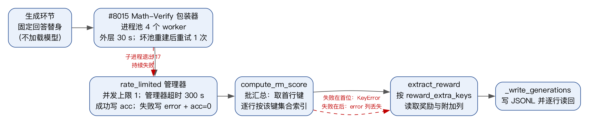
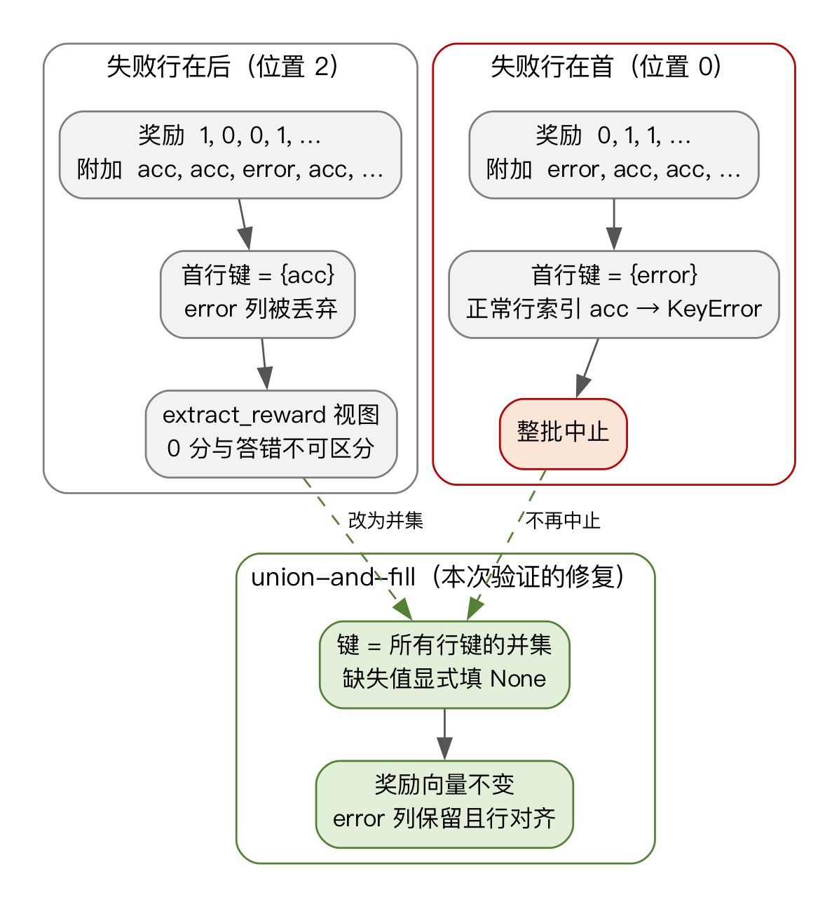
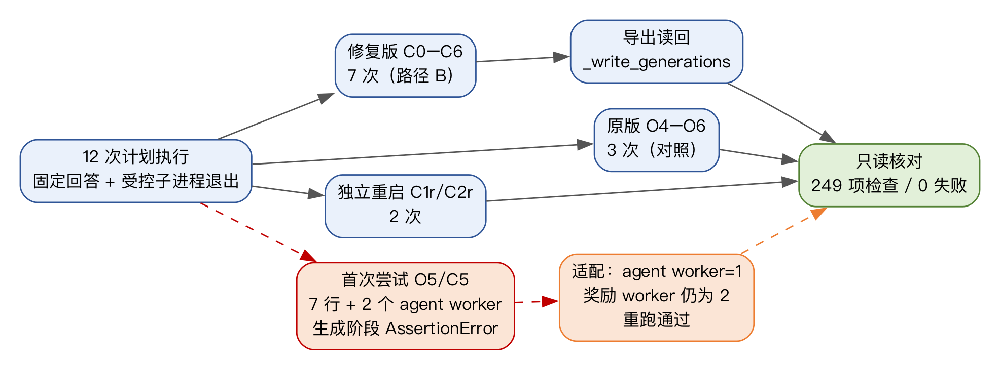
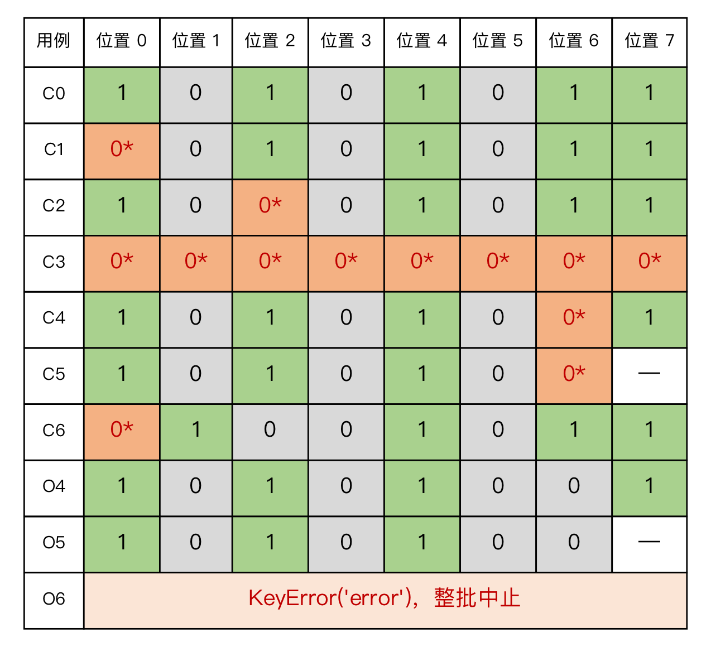

# 摘要

大语言模型强化学习中的可验证奖励通常被压缩为一个 0/1 分数：判分器返回 1 表示答案正确，返回 0 表示答案错误。然而，同一个 0 至少可能对应四种不同事件：答案确实错误、回答超出策略预算、判分器自身超时或异常、以及参考答案无法解析。当后两类事件发生时，奖励分数仍然是 0，但“这次判分没有完成”这一信息应当继续向下游传递，否则调试、数据清洗和训练诊断都会把基础设施故障误认为模型能力不足。

本文以开源强化学习框架 verl 中 Math-Verify 判分链路的一个固定版本为对象，研究失败信息在“判分包装器—奖励管理器—批汇总—结果读取—结果导出”链路上的传播。论文区分预算契约、可观测性契约和排除策略，提出“只有固定实现明确承诺了可观测性、而运行时行为违背该承诺时，才称为缺陷；没有明确契约时称为契约歧义”的判断口径。通过静态审计、受控故障注入、21 个固定判分输出的汇总契约案例、两轮 13 种真实链路情形和固定语料重放，本文确认了一个与行位置有关的机制：批汇总从首个样本的附加信息中取键集合，再按该集合索引所有行；失败行不在首位时，失败标记列被静默丢弃，失败行在首位时，正常行索引缺失键导致整批中止。相同回答仅因位置不同就产生“丢失”与“中止”两种结果。

在测量方面，本文在 93 733 条固定回答上以预先写定的阈值重放判分器，观察到 54 个判分器侧事件，其中 18 条仍未裁定、1 条在放宽时限后由 0 变为 1；有限样本恢复区间为 [1.07×10⁻⁵, 2.03×10⁻⁴]，未达到预先设定的“继续”或“停止”阈值，形式结论为“介于两者之间”。扩展到全部 193 767 条存储回答后，得到 2 条分数变化和 32 条未裁定回答，比例分别为 0.00103% 和 0.01755%。在 5 556 条人工标注回答上，没有观察到“失败事件零分”落在正标签上；该结果只说明所选样本上的零结果。重输入实验进一步显示，库内超时往往先于包装器外层超时发生，延长外层时限会改变执行策略而不是简单地“多等一会儿”。

在修复方面，本文只对批汇总做两行有界修改：取所有行附加键的并集，并对缺失项显式填入 None。在 21 个固定判分输出的汇总契约案例中，原实现有 16 个遗漏列、3 个抛出异常，修复后在全部 21 个案例上保持奖励向量和附加列对齐。为验证该修复在真实链路而非局部函数中有效，本文在隔离副本上执行了 12 次真实链路实验：修复版 C0–C6、原版 O4–O6 对照和 C1/C2 独立重启，并对每个完成批次执行真实结果导出和逐行读回。修复版全部通过，原版 O4/O5 完成但丢失 error 列、O6 在 reward_loop.py:369 以 KeyError 中止。另有两次 7 行批次的首次尝试在生成阶段因 2 个 agent worker 的等分块断言中止；原始记录被保留，随后只把该用例的 agent worker 设为 1、奖励工作进程仍为 2 重跑通过。只读核对脚本对全部记录执行 249 项检查，0 失败；两次失败尝试、驱动版本差异和配置差异均如实记录，没有手工填写或修改任何分数、错误文本与台账。

本文的贡献是：把“一个 0 的含义”拆成可检查的契约问题；给出失败信息在真实链路中丢失或中止的位置效应证据；在固定语料上给出带预先阈值的形式化测量；用真实链路、导出读回和原版对照验证一个有界修复；并总结出面向消费者的可观测性测试建议。补充的路径 A 固定输出探针确认路径 A 的汇总/消费者边界同样存在首行取键；固定语料重输入的 4 次批次传播则显示库内静默超时仍不可见，修复只覆盖已经写出的标记。结论只适用于固定版本、单机 CPU、小批量、固定回答和受控注入，不外推到自然故障率、训练收益、其他平台或其他路径。

**关键词：** 大语言模型；可验证奖励；奖励判分；故障传播；可观测性；GRPO

# Abstract

Verifiable rewards in large-language-model reinforcement learning are usually compressed into a binary 0/1 score: one for a correct answer, zero for an incorrect one. The same zero, however, can stand for at least four different events: a genuinely wrong answer, a response that exceeds the policy budget, a verifier timeout or exception, and a reference answer that cannot be parsed. When the last two occur, the score is still zero, but the fact that the scoring attempt did not finish should remain visible to downstream consumers; otherwise debugging, data cleaning, and training diagnostics mistake infrastructure failures for model errors.

This thesis studies failure propagation in a pinned Math-Verify scoring chain in the open-source reinforcement-learning framework verl. It distinguishes a budget contract, an observability contract, and an exclusion policy, and adopts the rule that behaviour is called a defect only when a pinned implementation states a contract and departs from it; otherwise the situation is reported as contract ambiguity. Through static auditing, controlled fault injection, 21 fixed-output aggregation fixtures, two rounds of 13 real-chain cases, and fixed-corpus replays, the thesis identifies a row-position mechanism: batch aggregation takes its key set from the first row and indexes every row by that set. When the failing row is not first, the failure column is silently dropped; when it is first, a normal row raises KeyError and the batch aborts. The same answer therefore produces either loss or abort depending on position alone.

On 93,733 fixed responses, a pre-declared replay observes 54 verifier-side events, 18 undecided rows, and one score change from 0 to 1 under a relaxed limit. The finite-sample recovery interval is [1.07×10⁻⁵, 2.03×10⁻⁴], between the pre-declared thresholds, so the formal verdict is "in between". Extending the replay to all 193,767 stored answers yields two changes and 32 undecided answers (0.00103% and 0.01755%). On 5,556 human-labelled answers, no failure-event zero intersects a positive label; this is a zero result on the selected sample. Heavy-input experiments show that library-internal timeouts often precede the outer wrapper wait, so extending the outer limit changes execution policy rather than simply waiting longer.

For repair, the thesis makes a two-line bounded change to batch aggregation: take the union of all rows' metadata keys and fill missing entries explicitly with None. On 21 fixed-output fixtures, the original implementation omits columns in 16 cases and raises in three; the repair preserves the reward vector and aligns every metadata column in all 21. To test the repair in the real chain rather than in an isolated function, 12 real-chain executions are performed on an isolated copy: repaired C0–C6, original O4–O6 controls, and independent restarts of C1/C2, each with real export and line-by-line readback. All repaired cases pass; original O4/O5 complete but lose the error column, and O6 aborts with KeyError at reward_loop.py:369. Two first attempts of the seven-row cases abort during generation because two agent workers require equal chunks; the raw records are preserved, and the cases are rerun with one agent worker while the reward workers remain two. A read-only verification script performs 249 checks with zero failures; failed attempts, driver-version differences, and configuration differences are recorded without fabricating or editing scores, error texts, or injection ledgers.

The contributions are: a contract-based decomposition of what a zero means; evidence of the position-dependent loss or abort in the real chain; a pre-declared measurement on a fixed corpus with finite-sample bounds; real-chain verification of a bounded repair with export readback and original controls; and design guidance for consumer-boundary observability. A supplementary 16-position fixed-output probe shows that path A's aggregation/consumer boundary has the same first-row key problem, while four fixed-corpus heavy-input batch runs show that silent library timeouts remain invisible; the repair only preserves markers that were written. The conclusions are limited to the pinned version, a single CPU machine, small batches, fixed responses, and controlled injection; they do not establish natural incidence, training gains, or behaviour on other platforms or paths.

**Keywords:** large language models; verifiable rewards; reward scoring; failure propagation; observability; GRPO

# 第1章 绪论

## 1.1 研究背景与意义

以大语言模型为对象的强化学习，近年来逐渐从“人类偏好奖励”转向“可验证奖励”。在数学、代码和部分推理任务中，只要最终答案可以被规则或符号工具判定，训练系统就可以直接给出 0/1 奖励，而不必训练一个可能被奖励黑客攻击的偏好模型。DeepSeek-R1、DeepSeekMath、Tulu 3 和 DAPO 等工作把这条路线推到了较大规模[1-4]。在这类训练中，判分器不是一个无关紧要的附属工具，而是整个学习信号的测量仪器：它给出的 1 决定哪些回答被强化，它给出的 0 决定哪些回答被抑制。

问题在于，0/1 是一种高度压缩的表示。一个 0 至少可能对应四类事件：回答确实错误；回答因为截断、轮数耗尽等原因超出策略预算；判分器自身超时、异常或工作进程死亡；参考答案本身无法解析。前两类是策略或数据问题，第三类基础设施问题，第四类数据问题。它们都写 0，但在训练、调试和数据清洗中应当被区别对待。如果判分失败被当作普通错误答案，训练就会把“没有测到”误认为“测到了错误”；如果失败样本被静默丢弃，分母和组内统计又会悄然改变。对于以可靠性为研究对象的网络空间安全专业，这类“测量链路自身是否可信”的问题与模型能力问题同样重要。

开源强化学习框架 verl 提供了一个具体的观察对象。verl 采用混合编程模型，把生成、奖励计算和训练拆成不同的 worker；奖励循环既可能在生成阶段逐样本计算，也可能在批处理阶段统一计算[5]。Math-Verify 是一个常用的数学答案判定库，提供解析、比较和超时控制[6]。verl 的 #8015 拉取请求为 Math-Verify 增加了一个带进程池和外层超时的包装器，并让 rate_limited 管理器在失败时写入 error 字段、同时把奖励记为 0[7]。从设计意图看，这是一个“可观测性契约”：失败不仅得到 0，还应当留下可追溯的标记。

但标记写在管理器里，不等于标记能到达消费者。verl 的批汇总代码从首个样本的附加信息中取键集合，再按这个集合索引所有行；当不同行的附加信息键不一致时，后面的行可能没有首行拥有的键，首行也可能没有后面行才有的键。上游 #6545 和 #7151 已经讨论过稀疏附加信息在不同路径上的问题[8-9]。本文关心的是：在一个固定版本、真实管理器、真实进程池和真实批汇总的链路上，失败标记究竟在何处丢失、在何处导致中止，以及一个最小的汇总修复能否在不改变奖励向量的前提下把标记保留到导出结果。

这项研究的意义有三点。第一，它把“判分器准不准”扩展为“判分链路是否把失败说清楚”。前者关注分数与数学真值的关系，后者关注分数背后的执行状态是否可追溯；两者不能互相替代。第二，它提供了一个可复现的机制案例：同一回答仅因所在行位置不同，就可能在“静默丢失标记”和“整批中止”之间切换。这种位置效应说明，只测试单个样本或只测试首行是不够的。第三，它给出一个有界修复和真实链路验证：修复只改批汇总的两行，不改变判分规则、不改变奖励数值，并用原版对照、导出读回和独立重启检查修复是否真的有效。

## 1.2 国内外研究现状

### 1.2.1 可验证奖励与 GRPO

可验证奖励强化学习（RLVR）的核心假设是：对于答案可判定的任务，规则判分器可以代替偏好模型，提供低成本的训练信号。GRPO 进一步用组内相对优势替代价值函数：对同一个问题采样多个回答，用组内奖励的均值和标准差归一化每个回答的 advantage[1-2]。这一设计降低了对 critic 的依赖，但也让单个奖励的误差更容易通过组内归一化放大：一个本应得 1 的回答被记成 0，不仅改变它自己的 advantage，还会改变同组其他回答的均值和方差。已有研究讨论了二值奖励下的梯度饥饿、组内相对优势的偏差以及验证错误对训练的延迟、平台或崩溃式影响[10-12]。这些工作主要从优化或训练结果出发，本文则从测量链路的可观测性出发，二者互补。

### 1.2.2 判分器可靠性与噪声奖励

围绕判分器本身，已有工作从多个角度展开。Xin 对 RLVR 奖励信号做了类别级审计，并研究了 GRPO 组内验证错误是否独立[13-14]；Cai 等研究不完美验证器下的噪声奖励强化学习[15]；Plesner 等讨论“不完美验证器也足够好”的条件[16]；Zhang 等提出面向强化微调的自动失败管理[17]；Hu 等分别提出相关性感知的重复验证审计和预算化的多验证器路由[18-19]；Tian 等从表示依赖的奖励黑客角度提出可靠性优先的 advantage[20]；Ray 对 RLVR 验证器做模糊测试[21]；Zhang 用预注册因果对比研究自然验证器假阳性[22]；Pan 讨论 RL 比较中的“陈旧数据”设置检查[23]。这些工作共同说明：判分器不是完美的真值来源，验证错误和验证成本都是真实存在的。

不过，上述工作大多把判分器当作一个“输入问题、输出分数”的黑盒，关注分数是否正确、噪声是否影响训练，或者如何用更多预算和更聪明的路由降低错误。本文把判分器放回它所在的工程链路，关注一个更窄但更基础的问题：当判分器已经明确报告“我没有完成”时，这条信息能否穿过管理器、批汇总、读取和导出，最终被消费者看到。这个问题不解决，许多针对判分器的审计和修复都可能在链路末端失去可观测性。

### 1.2.3 稀疏附加信息与工程契约

verl 的奖励循环允许管理器在返回奖励的同时返回附加信息字典。不同管理器、不同样本的附加信息键可能不同：成功的样本通常写 acc，失败的样本写 error 或 timeout。上游 #6545 讨论了“统一键”的期望，并实现了取并集的汇总方式；#7151 进一步指出 reward-loop、agent-loop 和异步路径上都存在稀疏附加信息的问题[8-9]。#8015 则在包装器层面承诺：持续失败时抛出异常，让奖励管理器标记该行[7]。这些讨论说明，工程上已经意识到稀疏键的风险，但“取并集”作为修复是否在真实链路上成立、失败标记是否能到达导出结果，仍缺少端到端的证据。

本文把这类问题表述为契约问题。预算契约说“正确意味着在给定计算预算内可证明正确”，因此超时记 0 是预期行为；可观测性契约说“失败尝试必须与否定判定可区分”，即使二者都得 0；排除策略则进一步规定未裁定样本是否从组统计、损失和分母中移除。三者可以独立成立或失败。一个实现如果只承诺了预算契约，却把失败标记丢掉，不一定是缺陷；如果它在代码、文档或拉取请求描述中明确承诺了可观测性，运行时却违背了该承诺，才可以称为缺陷。没有明确契约时，本文报告为契约歧义，而不是把设计选择写成 bug。

### 1.2.4 可复现性与评测记录

可复现性研究强调记录环境、版本、选择规则和失败尝试。Rollout Cards 提出为 agent 研究建立可复现性标准[24]。本文在实验部分沿用这一思路：固定源码提交、记录实际导入的模块路径和源文件哈希、保存原始异常和注入台账、把失败尝试和配置差异写入记录，而不是只保留成功结果。第 5 章的 12 次真实链路实验和只读核对脚本，就是这一原则的具体实现。

## 1.3 研究问题与目标

本文围绕一个总问题展开：在固定的 LLM 奖励判分链路上，判分失败的信息如何传播，为什么会在某些位置丢失或导致中止，以及一个有界修复能否在真实链路中保留奖励、样本对应和失败标记。具体分为三个研究问题。

RQ1（机制）：在 verl #8015 的固定版本中，失败标记从管理器到批汇总、再到读取和导出的路径上，在哪里、以什么条件丢失或中止？位置、分块、管理器类型和附加信息键集合分别起什么作用？

RQ2（测量）：在固定语料上，自然输入触发判分器侧事件和未裁定判定的频率如何？在预先写定的判定阈值下，应该得到“继续”“停止”还是“介于两者之间”的结论？重输入、超时层和并发恢复策略会怎样改变这个结论？

RQ3（修复）：只对批汇总做“取键并集、缺失填 None”的两行修改，能否在不改变奖励向量和判分规则的前提下，让失败标记在真实链路和导出结果中保持可追溯？原版对照和独立重启会给出什么结果？

研究目标是：把上述问题组织成一条可核对的证据链，给出适用于本科论文范围的、有明确边界的结论，而不是追求一个新的判分算法或一个大规模训练实验。

## 1.4 研究内容与贡献

本文的主要工作包括以下五个方面。

（1）契约化的问题表述。把“一个 0 是什么意思”拆成四类事件，并区分预算契约、可观测性契约和排除策略；提出“有明确契约才谈缺陷，否则谈歧义”的判断口径。这一表述让后续的机制、测量和修复有共同的验收语言。

（2）失败信息传播机制的证据。通过静态审计和受控故障注入，确认两条聚合路径都从首行取键；失败行不在首位时标记列被丢弃，失败行在首位时正常行索引缺失键导致 KeyError；同一回答仅因位置不同就切换结果。21 个固定判分输出的汇总契约案例进一步覆盖了 8 个位置、混合标记、空附加信息、正常输出和两个 worker 的补齐/裁剪边界。补充的路径 A 固定输出探针进一步确认：路径 A 的汇总/消费者边界也使用首行键，失败在位置 0 时 KeyError、在其余 7 个位置时丢列；union-and-fill 原型在 16 个位置都保留 error/timeout，但完整训练器仍未验证。

（3）固定语料上的形式化测量。在 93 733 条固定回答上以预先写定的阈值重放，报告 54 个判分器侧事件、18 条未裁定、1 条分数变化和有限样本区间；把结论限制在“介于两者之间”。扩展到 193 767 条回答，报告 2 条变化和 32 条未裁定；在 5 556 条人工标注回答上报告零结果；用重输入和并发实验说明超时层与恢复策略的交互。补充的 4 次固定语料重输入批次传播显示，库内静默超时仍以普通 0 返回、不写 error/timeout 标记，原版与修复版相同；修复只覆盖已经写出的标记。

（4）真实链路上的有界修复验证。只改批汇总两行，在隔离副本上执行 12 次真实链路实验：修复版 C0–C6、原版 O4–O6 对照和 C1/C2 独立重启；对每个完成批次执行真实 _write_generations 导出和逐行读回。修复版全部通过，原版 O4/O5 丢失 error 列，O6 以 KeyError 中止。两次 7 行首次尝试在生成阶段中止，原始记录被保留并说明，随后只调整 agent worker 数重跑通过。

（5）可复现记录与设计建议。给出固定版本、隔离副本、两行补丁、预检、原始记录、只读核对脚本和 249 项检查结果；总结出“在消费者边界验证契约”“把超时修改当作执行策略修改”“把可观测性与学习效果分开”等设计建议。

本文不声称提出了新的判分算法，也不声称修复了所有失败传播路径。修复只覆盖批汇总，不覆盖生成路径的拼接、naive 管理器的异常传播、库内静默失败和下游训练对 None 的接受策略。结论只适用于固定版本、单机 CPU、小批量、固定回答和受控注入。

需要说明本文与作者此前独立研究的关系。rewardfail 仓库和英文研究稿是作者此前完成的独立工作；本文复用了其中的两轮 13 种真实链路情形、21 个契约案例、固定语料测量、重输入实验和部分分析框架，并在此基础上增加了契约化表述、真实链路 12 次修复验证、导出读回、失败记录和论文层面的整合。本文不把已有工作重新包装成新发现；具体边界见 6.2 和附录 D。

## 1.5 论文组织结构

全文共七章。第 1 章介绍背景、研究现状、研究问题和贡献。第 2 章介绍 RLVR、GRPO、verl 奖励链路、Math-Verify 与 #8015 包装器，以及四类零分和三类契约。第 3 章分析失败信息的传播机制，包括首行取键、两条路径、位置效应、21 个契约案例和超时层的契约歧义。第 4 章报告固定语料测量，包括主测量、单条变化、重输入、全回答扩展和人工标签对照。第 5 章报告真实链路上的有界修复验证，包括修复设计、实验设计、环境隔离、结果、偏差和数据完整性。第 6 章讨论设计启示、与相关工作的关系、有效性威胁、伦理与可复现性。第 7 章总结全文并给出后续工作。参考文献、证据索引、复现说明、术语表和 AI 辅助说明放在文末。

# 第2章 背景与系统

## 2.1 可验证奖励与 GRPO

可验证奖励强化学习把“答案是否正确”交给一个可执行的判定器，而不是交给人类偏好或学习得到的奖励模型。对于数学题、代码题和部分形式化推理题，判定器可以读取模型回答和参考答案，经过抽取、规范化、符号比较或代码执行，返回一个离散奖励。与偏好奖励相比，可验证奖励的优点是便宜、稳定、可大规模运行；缺点是它把复杂的“回答质量”压缩为一个离散值，而这个离散值本身可能出错。

GRPO 是这类训练中常用的优化方法。对一个问题采样 G 个回答，记第 i 个回答的奖励为 r_i，组内均值为 r̄，样本标准差为 s，则第 i 个回答的 advantage 可以写成

A_i = (r_i - r̄) / (s + ε)，

其中 ε 是一个很小的常数，用来避免除零。这个式子有两个直接后果。第一，单个奖励的变化会改变整个组的均值和标准差，因此一个被误判的回答不仅影响自己，还会影响同组其他回答的 advantage。第二，当组内奖励全部相同（例如全 0 或全 1）时，标准差为 0，所有 advantage 都为 0，这个组不提供梯度。已有工作把后一种现象称为梯度饥饿，并讨论了二值奖励下组均值中心化的偏差[10-11]。本文不训练模型，但在讨论部分会用一个条件算例说明：把“未裁定”记成 0 与把它显式排除，会得到不同的 advantage 和不同的损失分母。

从测量链路的角度看，r_i 不是一个直接从“数学真值”读出的数，而是经过至少四层处理后的结果：回答文本被抽取成候选答案；候选答案与参考答案被规范化并比较；比较过程受解析时限、比较时限和外层等待约束；结果再经过管理器、批汇总和结果读取写入训练批次。任何一层都可能把“没有完成”写成 0。本文研究的正是最后几层：管理器、批汇总、读取和导出。

## 2.2 verl 奖励链路

verl 是一个面向大语言模型强化学习的混合编程框架，把生成、奖励、训练和推理拆成不同的 worker，以便在 Ray 上做资源调度[5]。与本文相关的奖励链路大致可以分成两段。

第一段是生成阶段。agent loop 在生成回答的同时，可能对每个样本调用一次奖励函数，把奖励和附加信息写回样本。这条路径下文称为路径 A。路径 A 的优点是反馈及时，缺点是每个样本单独处理，难以利用批处理；它的附加信息列在原始样本上，后续是否被训练器读取、如何读取，取决于具体的消费者代码。

第二段是批处理阶段。生成结束后，RewardLoopManager.compute_rm_score 把一批样本送到奖励工作进程，等待所有样本返回，再把每个样本的奖励和附加信息汇总成一个批。这条路径下文称为路径 B。路径 B 是本文第 5 章真实链路实验的主要对象，因为它同时涉及批汇总、补齐/裁剪和附加列写入，最容易暴露稀疏键问题。

在路径 B 中，奖励工作进程返回的是逐样本的字典列表。每个字典至少包含奖励，可能还包含 acc、error、timeout 等附加信息。批汇总需要把这些字典转换成两个东西：一个数值奖励向量，以及一个可以放进训练批的附加信息列集合。verl 的 DataProto 用张量或对象数组存放这些列，因此汇总代码必须决定“有哪些列”和“每列的长度是多少”。如果不同样本的字典键不一致，这两个决定就不再是显然的。

verl 的奖励管理器有两种常见实现。rate_limited 管理器限制并发、捕获异常，并在失败时返回奖励 0 和 error 字段；naive 管理器不捕获异常，失败会直接向上抛出。两者的区别很重要：rate_limited 的设计意图是“让失败变成可标记的 0”，naive 的设计意图是“让失败尽快暴露”。本文的机制分析同时覆盖两者，但真实链路修复只针对 rate_limited 下的批汇总，因为这是 #8015 明确承诺可观测性的路径[7]。

## 2.3 Math-Verify 与 #8015 包装器

Math-Verify 是一个常用的数学答案判定库，负责从回答中抽取候选答案、解析参考答案、做符号或数值比较，并提供解析超时和比较超时[6]。它的一个关键设计是：超时和异常可以被转换成特定的分数或异常类型，而不是让整个进程崩溃。具体到 verl 的 #8015 包装器，判分调用被放进一个进程池，外层再包一个等待时限；如果子进程持续失败或进程池损坏，包装器会重建进程池并重试一次，仍失败则抛出异常，让管理器把该行标记为失败[7]。

这个包装器解决了一个工程问题：判分库可能卡住或崩溃，不能让它拖垮整个训练进程。但它也引入了一个新的语义问题：包装器抛出异常时，管理器知道“这一行失败了”；包装器内部库超时但包装器没有抛出异常时，管理器只看到“这一行得了 0”。#8015 的讨论和本文的超时实验都表明，库内超时通常先于外层等待发生，timeout_score 参数并不总能覆盖库内超时[25]。因此，“失败标记”是否出现，取决于失败发生在哪一层、被谁捕获、以什么形式返回。

本文固定使用 #8015 的头版本 0c4c3d40d46d5f47d1918c905641eea969b7fa09 和 Math-Verify 0.9.0。固定版本很重要：判分库和框架都在快速变化，同一个函数名在不同提交上可能有不同的异常处理；只有固定版本，才能把“代码这样写”和“运行时这样表现”对应起来。

## 2.4 四类零分与三类契约

下表给出四类零分的例子和责任归属。这个分类不是要否认“0 就是 0”在训练中的直接作用，而是提醒读者：0 的生成原因不同，后续处理也应该不同。

| 事件 | 例子 | 责任方 |
| --- | --- | --- |
| 普通否定 | 答案确实不等，或抽取策略没有接受任何答案 | 策略 |
| 策略超预算 | 回答被截断、轮数耗尽 | 策略 |
| 判分器未裁定 | 库超时、库异常、工作进程死亡、进程池损坏 | 基础设施 |
| 数据侧失败 | 参考答案本身无法解析 | 数据 |

表 2-1 一个 0 可能代表的四类事件

围绕这四类事件，本文区分三种契约。预算契约说“正确意味着在给定计算预算内可证明正确”，因此超时记 0 是契约的一部分，不一定是缺陷。可观测性契约说“失败尝试必须与否定判定可区分”，即使二者都得 0；它要求失败标记在消费者可见的返回值中存在，并且能被追溯到具体样本。排除策略则进一步规定：未裁定的样本是否从组统计、损失和分母中移除，以及移除后如何保持批次对齐。三者可以独立成立：一个系统可以遵守预算契约但违反可观测性契约；也可以保留失败标记但不规定排除策略；还可以两者都做对，但下游消费者不识别 None。

本文采用一个保守的判断口径：只有当固定实现通过代码注释、文档或拉取请求描述明确承诺了某个契约，而运行时行为违背该承诺时，才称为缺陷；没有明确契约时，称为契约歧义。这个口径避免把设计选择写成 bug，也避免用“我觉得应该这样”代替可核对的承诺。例如，库内超时没有触发 timeout_score，如果没有任何文档说 timeout_score 应当覆盖库内超时，本文就把它报告为歧义，而不是缺陷。

另一个重要区分是默认协议和诊断协议。默认协议指库的默认时限、框架的默认路由和平台默认配置；诊断协议指为了观察失败而主动改变参数（例如把比较时限从 5 秒放宽到 60 秒，把外层等待从 30 秒放宽到 300 秒）。诊断协议下看到的结果不能被写成默认行为。本文在第 4 章会反复使用这个区分：主测量用默认协议，重输入和放宽时限实验用诊断协议，两者分开报告。

## 2.5 本章小结

本章介绍了 RLVR 与 GRPO 的基本背景、verl 奖励链路的两条路径、Math-Verify 与 #8015 包装器的设计、四类零分和三类契约。核心结论是：一个 0 不是单一事件；判分失败是否可观测，取决于管理器、批汇总、读取和导出是否共同履行可观测性契约。下一章将进入代码和实验，分析失败信息在批汇总中的具体传播机制。

# 第3章 失败信息的传播机制

## 3.1 首行取键与稀疏列

verl 的批汇总需要把逐样本的附加信息字典转换成批级别的列。最直接的写法是：先看第一个样本有哪些键，再按这些键逐行取值。这个写法在代码上很短，在语义上却隐含了一个很强的假设：所有样本的附加信息键集合相同，或者至少第一个样本的键集合是所有样本键集合的超集。失败样本的存在恰好打破了这个假设。

可以把有问题的写法抽象成如下伪代码：

\`\`\`python
reward_extra_keys = list(reward_extra_infos[0].keys())
for key in reward_extra_keys:
    non_tensor_batch[key] = np.array(
        [info[key] for info in reward_extra_infos], dtype=object
    )
\`\`\`

第一行只读取第 0 个样本的键。第二行对每一行执行 info[key]：如果某个后面的样本没有第 0 个样本拥有的键，就会抛出 KeyError；如果某个后面的样本拥有第 0 个样本没有的键，这个键根本不会出现在 reward_extra_keys 里，整列被静默丢弃。前一种情况让批次中止，后一种情况让失败标记消失。两种结果都不需要判分结果发生变化，只需要行位置或键集合发生变化。

这个机制与上游 #6545 讨论的“统一键”问题同源[8]。#6545 提出取所有行键的并集；#7151 指出 reward-loop、agent-loop 和异步路径上都存在类似问题[9]。本文的工作不是重新发现稀疏键，而是把这个机制放到 #8015 的真实管理器、真实进程池和真实批汇总中，观察它在运行时的具体表现，并区分“丢失”和“中止”两种后果。

## 3.2 两条路径与位置效应

如第 2 章所述，奖励计算可能发生在生成阶段（路径 A）或批处理阶段（路径 B）。两条路径都使用“从首行取键”的汇总方式，但它们的下游消费者不同。路径 A 在逐样本返回时保留了一个原始的附加信息列；路径 B 在批汇总后把结果交给 extract_reward，再由训练器或导出函数读取。本文的受控故障注入覆盖了两条路径；真实链路修复验证只覆盖路径 B。

实验使用 #8015 头版本的 Math-Verify 包装器、rate_limited 管理器、真实奖励工作进程和两条聚合路径。生成被替换为固定回答文本，因此不加载模型；持续失败通过让判分子进程在被标记的回答上调用 os._exit(17) 注入，每次注入都由一个台账记录。13 种情形变化了失败行的位置、是整块失败还是整批失败、以及使用哪个管理器；两轮记录在 results/c1c/run1 和 run2 中，执行提交为 cc87848。

两轮运行暴露了相同的结果。最关键的是位置效应：

- 失败行不在首位时，批次完成，失败行贡献 0 分，但 extract_reward 返回的奖励中没有失败标记；从返回值看，这次失败与普通答错不可区分。生成路径上的原始逐样本列仍然保留标记，但本文没有运行完整训练器去确认是否有下游代码读取它。
- 失败行在首位、其他行正常时，批汇总抛出 KeyError，整批中止。把同一个原本正确的回答从后面的位置移到首位，就能复现这个切换；决定结果的是位置，不是回答内容。
- 整块失败时，键不匹配或跨块元数据不一致会触发断言失败；整批失败时，0 分和标记反而一致返回。
- 默认的 naive 管理器下，同样的失败会以真实原因中止批次，因为管理器不捕获异常。也就是说，“把失败变成带标记的 0”这一设计只在 rate_limited 管理器下成立。

图 3-1 用两个分组示意了这个机制。失败行在后时，首行只有 acc 键，error 列被丢弃；失败行在首时，首行有 error 键，正常行没有 error 键，索引正常行就抛出 KeyError。修复的做法是取所有行键的并集，并对缺失项显式填 None；这样奖励向量不变，error 列保留，行对齐也保持不变。

需要强调的是，图 3-1 是机制示意，不是一个新的测量批次。它说明的是首行取键规则在两种位置下的后果；真实链路的数值结果在第 5 章。另一个限制是：路径 A 的原始列是否会被训练器读取、读取后是否会被后续处理正确使用，本文没有做完整训练器验证。因此，“路径 A 仍保留标记”只是一个代码层面的观察，不能写成“路径 A 没有问题”。

### 3.2.1 路径 A 的固定输出探针

为了确认路径 A 是否只是“原始列保留”，本文用真实的 AgentLoopWorker._postprocess 和 extract_reward 做一个固定输出探针。构造 8 个 _InternalAgentLoopOutput，把 error 和 timeout 分别放在 8 个位置；不加载模型、不启动 Ray、不进入完整训练器。原实现中，失败在位置 0 时 KeyError，批次中止；失败在位置 1–7 时完成，但 extract_reward 只看到 acc，error/timeout 列被丢弃。对同一函数源码做两行 union-and-fill 替换后，16 个位置都完成，error/timeout 列保留，奖励向量不变。

| 情形 | 原实现 | union-and-fill 原型 |
| --- | --- | --- |
| error 在位置 0 | KeyError，批次中止 | 完成，保留 error 列 |
| error 在位置 1–7 | 完成，只有 acc 列 | 完成，保留 error 列 |
| timeout 在位置 0 | KeyError，批次中止 | 完成，保留 timeout 列 |
| timeout 在位置 1–7 | 完成，只有 acc 列 | 完成，保留 timeout 列 |

表 3-1 路径 A 的固定输出探针（16 个位置；奖励向量不变）

这说明路径 A 的汇总/消费者边界也有同样的问题，而不只是“代码里保留了一个原始列”。它把“路径 A 仍保留标记”的代码观察推进到可执行的固定输出检查。边界也必须说清楚：这只到 extract_reward，没有验证完整训练器的 loss/advantage/模型行为；union-and-fill 是本地函数源码替换，不是上游补丁；探针不加载模型、不启动 Ray，不能代替真实链路。

补充的只读数据流核对显示，error 列虽然能进入 non_tensor_batch，但默认 GRPO 的 compute_advantage 只读取 uid 和 token_level_rewards；error 列不进入默认 loss/advantage，主要供日志、导出和可选过滤。这不是完整训练器运行验证，但说明“路径 A 保留列”不等于“训练会使用它”；如果下游不读取或只记录，修复的可观测性收益仍停在导出/诊断层。

## 3.3 21 个汇总契约案例

为了把“首行取键”问题从单个观察变成可重复的契约检查，本文使用 21 个固定判分输出的汇总案例。每个案例都绕过真实判分器，直接给批汇总提供构造好的逐样本奖励和附加信息字典；这让我们可以精确控制每个位置上的键，而不受判分器随机性的影响。案例覆盖：

- error 标记在 8 个位置各一次；
- timeout 标记在 8 个位置各一次；
- 混合标记（同一批中同时有 error、timeout 和正常样本）；
- 空附加信息；
- 正常输出；
- 两个 worker 下的补齐与裁剪边界。

在原始实现上，16 个案例出现附加列遗漏，3 个案例抛出异常；修复后的实现在这 21 个案例上全部返回预期的奖励向量和对齐的附加值。修复只改两个赋值：第一，奖励键集合取所有行键的并集；第二，对缺失项填 None，并以对象数组保存。它不改变判分逻辑，不改变奖励数值，也不改变样本顺序。

这三个要求可以形式化地写成：键完整性，保留所有行键的并集；行对齐，每个附加列在补齐和裁剪后仍然与奖励向量一一对应；奖励保持，增加观测元数据不改变数值奖励向量。对于没有补齐的批次，还可以推出一个可执行的蜕变检查：对行做置换 π，汇总后的奖励应当等于原奖励的 π 置换，附加列也应当按 π 置换，键集合不变。把失败行移到首位之所以违反这个检查，是因为判分输出没有变，变的是汇总对首行的依赖。

这组案例的边界也必须说清楚：它是局部原型的回归测试，不是完整判分器或训练运行；它使用固定的判分输出和替代的 Ray 传输；它不修复生成路径的拼接、naive 管理器的异常传播，也不验证下游训练是否接受 None 或如何制定排除策略。它的价值在于把“首行取键”这个机制变成可重复的契约检查，为第 5 章的真实链路验证提供预期。

## 3.4 超时层的契约歧义

除了稀疏键，失败信息还可能因为超时层而被“压平”。Math-Verify 在库内捕获自己的超时，把它转换成失败或 0 分；#8015 包装器又在外层包了一个等待。包装器的 timeout_score 参数本意是把库超时映射成一个可识别的分数，但在默认参数下，库内超时先发生，包装器的超时分支根本没有被触发。本文做了一个小实验：把 timeout_score 设为 -7，观察库内超时和外层超时的实际返回。结果是，库内失败仍然是 0 或 1；只有外层 30 秒等待或显式抛出的超时才返回 -7。

在一个受控的慢比较中，两个原本正确的回答在默认时限下降为 0，第三个回答通过字符串回退仍然得到 1。这个结果说明，延长或调整超时并不只是“多等一会儿”：它会改变哪一层先结束、哪一层捕获异常、以及失败被写成 0 还是被标记。由于没有任何固定文档说明 timeout_score 应当覆盖库内超时，本文把这个现象报告为契约歧义，而不是缺陷。第 4 章的重输入和并发实验会进一步说明，超时层的变化还会影响进程池的恢复策略和相邻请求。

## 3.5 本章小结

本章给出了失败信息传播的核心机制：批汇总从首行取键，失败行在后时错误列被静默丢弃，失败行在首时正常行索引缺失键导致整批中止；同一回答仅因位置不同就切换结果。21 个契约案例把这个机制变成可重复的检查，并验证了两行 union-and-fill 修复在局部函数上的效果。超时层则展示了另一种“压平”：库内超时先于外层等待发生，timeout_score 未必被触发，缺少明确契约时只能报告为歧义。下一章转向固定语料，测量自然输入触发这些事件的比例和边界。

# 第4章 固定语料测量

## 4.1 数据与协议

第 3 章说明失败信息可能丢失或中止；本章要回答的是“自然输入有多常见”。这里的“自然”有两个限制：输入来自固定语料，判分器是固定版本，重放是隔离执行的；它不是对训练分布的无偏抽样，也不是自然发生率的估计。

主测量使用 OpenR1-Math-220k 中每个问题取一条回答所形成的 93 733 条样本[26]。每条回答在隔离进程中通过固定的 Math-Verify 包装器重放，默认协议为库内解析/比较 5 秒、外层等待 30 秒。为控制选择偏差，主测量在开始前固定了判定阈值和抽样规则；其中 1 000 条默认得 1 的回答作为对照，47 条被选中的回答各重放三次，963 条回答做了一次整体重测。重测只用于检查稳定性，不改变主测量的分母。资源保护、进程中断和人工操作都单独记录，不能当作自然结果。

需要特别说明数据来源与选择偏差。该数据集的题目来自 NuminaMath 1.5，发布前已经由 Math-Verify 或 LLM judge 过滤，每个问题至少有一条被判为正确的回答；本文按问题文本的固定哈希为每个问题选一条回答，不使用数据集的 uuid，因为 uuid 在 664 行缺失、并被 60 对不同问题共享。这样得到的 54 个判分器侧事件是**过滤后语料上的条件计数**，不能当作自然训练分布的发生率，也不能假设偏差方向。

需要区分默认协议和诊断协议。默认协议使用库和框架的默认时限；诊断协议为了观察失败而放宽时限、改变并发或关闭某些保护。本文只把默认协议的结果写进主结论，诊断协议的结果用于解释机制和边界。这个区分在重输入、超时敏感性和人工标签部分尤其重要。

## 4.2 主测量

在默认协议下，93 733 条回答中有 45 条零分样本出现了判分器侧事件，另有 9 条样本在某个候选比较中出错、但通过另一个候选比较仍然得到 1。两者合计 54 个判分器侧事件。没有一条回答触发外层 30 秒等待、破坏进程池或让包装器抛出异常；没有一条回答的判分时间超过 10 秒。47 条被选中的回答三次重放结果一致，963 条整体重测没有改变任何结果。

真正需要单独处理的是 18 条未裁定样本：其中 14 条在 60 秒比较下仍然超时，1 条在解析参考答案时超时，2 条被中断两次，1 条被本机资源保护停止。最后三条是本机资源干预，不是自然结果。放宽到参考时限后，恰好有 1 条回答由 0 变为 1；其余 18 条仍未被判定。1 000 条默认得 1 的对照全部保持 1。

用 k 表示由 0 变为 1 的条数，u 表示仍未裁定的条数，n 表示主测量样本数，则 k=1、u=18。有限样本恢复区间为 [1.07×10⁻⁵, 2.03×10⁻⁴]。在 k=1、u=18 下，(k+u)/n 的单侧 95% 二项模型上界为 2.97×10⁻⁴；k/n 的双侧 95% 区间为 [2.7×10⁻⁷, 5.9×10⁻⁵]。这两个区间都没有达到预先写定的“继续”或“停止”阈值，因此形式结论是“介于两者之间”，而不是“验证器错误很常见”或“验证器完全可靠”。区间端点的计算使用 Clopper–Pearson 方法[27]。

这个结论依赖“参考答案没有被回填”这一前提。如果 18 条未裁定样本在某个更长时限下全部得 0，上界会低于 10⁻⁴；如果全部得 1，k 会变成 19，仍然远低于继续阈值。也就是说，即使把未裁定样本极端地全部算作 0 或全部算作 1，结论的大方向不变；但这不意味着我们可以忽略未裁定样本，因为它们影响的是“失败是否可观测”，而不只是“错误率是多少”。

下表汇总了主测量的关键数字。

| 指标 | 数值 |
| --- | --- |
| 主测量回答数 n | 93 733 |
| 零分样本中的判分器侧事件 | 45 |
| 得分 1 但出现候选比较错误 | 9 |
| 未裁定回答 u | 18 |
| 由 0 变 1 的回答 k | 1 |
| 有限样本恢复区间 | [1.07×10⁻⁵, 2.03×10⁻⁴] |
| (k+u)/n 的单侧 95% 上界 | 2.97×10⁻⁴ |
| k/n 的双侧 95% 区间 | [2.7×10⁻⁷, 5.9×10⁻⁵] |
| 形式结论 | 介于“继续”与“停止”之间 |

表 4-1 主测量的关键数字

## 4.3 单条变化与时限敏感性

唯一一条由 0 变 1 的回答值得单独检查，因为它说明“0”与“1”之间可能只隔着一个时限。在同一个已经预热的进程池上连续重放十次，5 秒比较时限下每次都超时（比较墙钟 5.002–5.005 秒），得 0；参考时限下每次都得到 1，比较墙钟 5.82–7.51 秒，中位数 6.21 秒。十次重放共享进程池和 SymPy 缓存，不是独立样本；第一次重放的参考答案解析时间为 0.11 秒，之后小于 0.001 秒，缓存状态没有被控制。十次结果都显示同一种“时限依赖”模式，但这只说明本机上的现象，不能外推到其他硬件或独立运行。

另有 928 条回答在 2 秒和 10 秒时限下重新判分，其中 3 条随时限改变：2 条在 2 秒时得 0、在 5 秒和 10 秒时得 1；1 条（就是上面的 k 条）只在 10 秒时得 1。这个敏感性说明，时限不是中立的测量参数；改变时限会改变哪些回答被算作正确。对于本文关心的可观测性，这个结果还有一层含义：超时被写成 0 时，消费者无法仅从分数判断它是“算错了”还是“没算完”。

## 4.4 重输入与并发

主测量中有 4 条未裁定样本的参考答案特别重。本文用独立进程直接调用包装器的 worker 函数，库内时限 60 秒，每 10 秒转储一次线程栈，并在内存占用超过 1.5 GiB 或墙钟超过 120 秒时停止（停止前再转储一次栈）。这四个停止点是栈捕获端点，不是方法本身的资源上限。

四条样本的栈都停在同一个位置：Math-Verify 的数值相等判断调用 SymPy 的 doit()，后者在 Integer._eval_power 中计算整数幂。三条样本对应同一个递归函数任务 f(4,1981)，参考答案包含嵌套幂：-3+2^(2^1984)、2^(2^1984)-3 和 2^(2^1984-3)；最后一条的参考答案是 0，回答中包含 5^(5^(5^(5^(5))))。前三条样本的内存在前 15 秒以 82–88 MiB/s 增长，约 18 秒达到 1.5 GiB 端点，窗口内没有看到增长放缓；第四条内存增长较慢（峰值 351 MiB），60 秒闹钟按时终止比较，得 0。默认 5 秒时限下，四条都在闹钟处停止并得 0，没有触发外层等待，也没有破坏进程池。

其余 14 条未裁定样本用 300 秒库内时限、1 500 秒外层等待重判一次，这是一次有界敏感性分析，不是新的真值。结果没有一条得 1：11 条比较达到 300 秒墙钟，1 条参考答案解析达到 300 秒；2 条比较在 81 秒和 281 秒完成并返回不等。把 4 条重输入仍算作未裁定，得到 k_300=1、u_300=16；单侧 95% 上界为 2.72×10⁻⁴，k_300/n 的下界为 5.5×10⁻⁷，结论仍然介于两个阈值之间。对回答字符串的初步阅读（不是真值）认为，12 条仍未裁定的样本中有 10 条写的是参考答案、2 条不是；这与两条已完成的 0 分一致。也就是说，把时限放大 60 倍只决定了 14 条中的 2 条，且都是 0。

重输入还会影响并发和恢复。本文用两个包装器（主版本和 #8015 版本）、两种库内时限（5 秒和 60 秒）和固定的 30 秒外层等待，构造了 40 个场景：每个场景先用固定哈希顺序选出的 64 条对照回答，然后在位置 1 或 33 放入一条回答重输入，或者在位置 1 放入一条参考答案重输入，每个场景最后再跑一批 64 条对照。所有重输入都得 0，所有对照都得 1，后续对照也得 1。5 秒时限下，重输入判分在 5.03–5.34 秒返回，没有重置进程池；60 秒时限、30 秒外层等待下，重输入在 30.00–30.18 秒返回 0；#8015 包装器在 9 个重输入场景中都重置了进程池，主版本一个都没有重置。主版本的子进程重计算在后续对照批次结束后约 29.72–29.92 秒才结束，说明“返回 0”并没有停止后台工作；场景关闭时等待了这段工作，因此这不是训练卡顿的直接观测。

另一个矩阵使用前 8 条对照回答，分别测试 naive 管理器（8 个请求线程）和 rate_limited 管理器（并发 1），库内时限 5 秒或 60 秒，外层 30 秒。16 个场景全部完成，没有资源干预。5 秒时限下，两种管理器在两个包装器上都返回 3 个 0 和 5 个 1；60 秒时限下，naive 管理器在 #8015 包装器上抛出 BrokenProcessPool，没有返回整批奖励，而 rate_limited 管理器和主版本包装器返回 3 个 0 和 5 个 1。后续对照全部得 1。这个结果与 #8015 讨论中已经报告过的并发重置交互一致；本文只是用真实判分输入和批结果补充了工程记录，不声称首次发现该交互。

还有 14 个顺序调用场景：每个包装器各有 7 个一次性场景，覆盖 5 秒/30 秒、60 秒/30 秒下的纯对照和三个重输入，以及 60 秒/300 秒下 naive 管理器的纯对照、单重输入和三个重输入。全部完成，没有资源干预；所有正常回答得 1，所有重输入得 0。60 秒/30 秒下，#8015 包装器重置了 3 次进程池但仍返回所有行结果，主版本没有重置；60 秒/300 秒下，库内比较在外部等待之前结束，两个包装器都没有重置，naive 批次也返回了。这个对照说明，前面的批中止更可能与并发外层超时恢复有关，而不是单条重输入本身；它不证明所有并发模式或时序环境都一样。

### 4.4.1 固定语料重输入的批次传播（补充）

为了检查“修复能否处理固定语料中的重输入”，本文从历史 D1 的四条重输入中取标准答案和 R1 回答，用固定回答替身、真实 AgentLoopManager、RateLimitedRewardManager 和 Math-Verify 跑 8 行批次；不做故障注入。H1 把一条重输入放在位置 2，H3 把三条放在位置 0–2；原版和修复版各一次，共 4 次，全部完成。H1 的分数为 [1,0,0,0,1,0,1,1]，原版/修复版墙钟分别为 14.58 秒和 15.44 秒；H3 的分数为 [0,0,0,1,0,1,0,1]，墙钟分别为 26.17 秒和 24.73 秒。四个结果的 extract_reward 都只有 acc，没有 error 或 timeout 列；原版和修复版相同。

日志中出现“Timeout during comparison”，但库内比较超时被 Math-Verify 正常返回为 0，没有抛异常，管理器没有写 error/timeout 标记。两行修复只能保留已经写出的标记，不能把库内静默超时变成可观测事件。这个补充把“重输入会超时”与“超时是否可观测”分开：固定语料中的重输入是修复边界之外的层，不能拿它替代受控稀疏键注入，也不能据此估计自然发生率。它的价值是负面的：它说明“保留并导出标记”并不等于“所有失败都可观测”，修复还需要上层把静默超时转成显式标记。

## 4.5 全回答扩展

主测量固定之后，本文把重放范围扩展到主样本之外的 100 034 条回答。问题身份使用问题文本的 SHA-256 加回答索引；93 733 个问题字符串共对应 193 767 条回答（每个问题 1–6 条）。新增回答使用同样的 5 秒/30 秒默认协议；所有未得 1 的 32 704 条回答在 60 秒/300 秒下重跑，另按固定哈希顺序选 1 000 条默认得 1 的回答作为对照。代码、数据、选择规则和基线哈希在重放前锁定。

补集里有 1 条由 0 变 1、14 条未裁定（13 条比较超时、1 条参考答案解析超时）；1 000 条对照全部保持 1。把补集计数与主测量的审计计数合并，得到 193 767 条回答中 2 条变化、32 条未裁定；对应的有限语料比例为 2/n 和 34/n，即 0.00103% 和 0.01755%。这两个数是描述性端点，不是置信区间，也不套用主样本的判定规则。第二条变化来自主样本中那条对时限敏感的问题的另一个回答，不是第二个独立问题。

完整默认重放中有 103 条回答出现判分器侧事件，85 条得 0，18 条通过另一个候选比较仍得 1。92 287 个至少有两个回答的问题中，59 个出现过事件，42 个有两个回答都出现事件。把“出现事件的一个回答”与“同一问题的另一个回答”组成有序对，共有 103 对，其中 84 对两端都有事件（81.55%）；没有其他端点存在不完整观测。这个分母排除了单回答问题，并按事件锚点和其他回答的数量给问题加权；42 个多事件问题都只有两个存储回答。相同参考答案和问题内容、不同重放时间和未控制的缓存，都可能共同解释这种共现；本文不估计相关参数、训练错误率或八个回答的 GRPO 组内依赖。

补集的默认重放耗时 14.2 分钟；参考控制器有一次丢失了一个未完成回答，原因没有记录；同一目录和版本锁被恢复，已完成工作和中断尝试被保留。报告的 20.4 分钟只描述恢复后的控制器，不是全部参考工作或中间间隔。补集没有出现红色资源压力，最高记录为警告。原始事件重组和独立的计数/配对重建与存储报告一致。

## 4.6 人工标签对照

本文还使用了 Xin 发布的 1.5B 模型回答的人工标注数据[28]。该数据包含 5 556 条回答，其中 2 822 条正标签、2 734 条负标签，来自 3 041 个组；采样按类别和验证器意见分层，不是训练分布上的随机样本。只有 72 个组包含全部八个回答位置；200 条双标注行在两个标注列上一致，本文没有独立裁决标签。输入是已经抽取的回答，不是主测量中的完整生成推理。

每条回答先在隔离环境中按原样重放，再在缺少 \boxed 的情况下用 \boxed{...} 包裹后重放；每种呈现分别使用默认 5 秒/30 秒和 60 秒/300 秒。24 条已经带 \boxed 的回答复用已有分数，不再创建第二次相同试验。因此，每种呈现和时限条件下有 5 556 条标签对齐行，实际试验共 22 176 次；输入字符串、源哈希和别名映射在测量前固定。所有行都有完整观测记录，没有资源干预。这里的普通 0 表示没有观察到判分器侧事件，不一定表示比较已经完成且判定不等；按指定格式策略抽取为空也会产生 0。

下表给出默认和放宽时限下的标签分歧。两种呈现下，分数在两种时限之间完全相同。原样呈现下，1 530 条回答分歧：1 487 条正标签得 0，43 条负标签得 1；显式分隔符呈现下，204 条分歧：113 条正标签得 0，91 条负标签得 1。最后一列是默认/放宽时限下的失败事件数：原样呈现为 3/2，显式分隔符呈现为 4/3；这些回答全部是负标签。

| 呈现方式 | 正标签/得 0 | 负标签/得 1 | 分歧合计 | 失败事件（默认/放宽） |
| --- | ---: | ---: | ---: | ---: |
| 原样 | 1 487 | 43 | 1 530 | 3/2 |
| 显式分隔符 | 113 | 91 | 204 | 4/3 |

表 4-2 人工标签对照中的分歧与失败事件

两种呈现下，没有观察到“失败事件 0 分”落在正标签上（0/2 822）。放宽时限每种呈现各消除 1 个比较超时事件，但没有改变任何分数。这是一个所选样本上的零结果，不是“超时不可能掩盖正确答案”的证明。显式分隔符把 1 431 个 0 变成 1、把 9 个 1 变成 0，降低了总分歧，却把负标签得 1 的数量从 43 提高到 91；因此大部分分歧不能归因于观察到的超时事件。分隔符条件是一种显式输入变换，不是在完整生成回答上验证的修复，也不是新的验证器方法。

## 4.7 本章小结与边界

本章在固定语料上给出了三层结果。主测量显示判分器侧事件很少但并非为零：54 个事件、18 条未裁定、1 条分数变化，形式结论介于两个阈值之间。重输入和并发实验显示，库内超时、外层等待和进程池恢复策略会相互作用，延长时限不是简单的“多等一会儿”。全回答扩展得到 2 条变化和 32 条未裁定，人工标签对照在所选样本上没有发现失败事件与正标签相交。所有这些结论都受固定语料、固定版本、单机、重放协议和选择规则的限制，不能外推为自然发生率或训练效果。

下一章把视角从“测量”转到“修复”：如果失败信息已经产生，能否用一个最小的批汇总修复让它在真实链路和导出结果中保持可追溯？

# 第5章 真实链路上的有界修复验证

## 5.1 修复设计

第 3 章的 21 个契约案例说明，两行修改可以在局部函数上保留失败标记；但局部函数通过不等于真实链路通过。真实链路里还有 Ray 工作进程、管理器、进程池、批汇总、extract_reward 和 _write_generations 导出。任何一个环节的列名、长度或空值处理不一致，都可能让修复在最后一步失效。第 5 章要验证的就是：把同样的两行修改放进隔离副本，在真实链路上跑完 12 次执行，失败标记是否真的保留到了导出结果。

修复本身很短。原始批汇总从第一行取键，修复改为取所有行键的并集，并对缺失项显式填入 None。它满足三个要求：键完整性，保留所有行键；行对齐，每个附加列在补齐和裁剪后仍与奖励向量一一对应；奖励保持，增加观测列不改变数值奖励。它不改变判分器、不改变管理器、不改变奖励数值，也不改变训练器的排除策略。

这个修复不是本文提出的新算法。上游 #6545 已经讨论过取并集的汇总方式，#7151 也指出稀疏附加信息在多条路径上的问题[8-9]。本文的工作是把该思路作为一个有界候选，放到 #8015 的真实链路上验证，并明确它不覆盖哪些路径。修复只针对 rate_limited 管理器下的路径 B 批汇总，不覆盖生成路径 A 的拼接、naive 管理器的异常传播、库内静默失败和下游训练对 None 的接受策略。

## 5.2 实验设计

实验使用固定回答替身，不加载模型；持续失败通过让判分子进程在带标记的回答上调用 os._exit(17) 注入，每次注入写入一个台账。这样既保留了真实的 Ray 奖励工作进程、真实 rate_limited 管理器、真实 #8015 包装器和真实批汇总，又避免了模型生成带来的随机性和资源消耗。

下表给出 12 次计划执行的设计。C0 是正常批次；C1–C6 分别在首行、后续行、全部行、第二个分块、7 行补齐/裁剪和重排位置注入失败；O4–O6 是原版对照；C1r/C2r 是 C1/C2 的独立重启。C5 只取原始编号 0–6，共 7 行，奖励工作进程内部补成 8 行再裁回 7 行；C6 把 C2 的整行重排为 [2,0,1,3,4,5,6,7]，仍只在原始编号 2 注入，用来检查“按原始编号还原”而不是只看分数总和。每个完成批次都调用真实 _write_generations 写 JSONL，再逐行读回；另做一个长度不等于样本数的附加列检查，确认它被忽略。

| 用例 | 输入与故障 | 修复后应观察到 | 原版对照 |
| --- | --- | --- | --- |
| C0 | 原始顺序 0–7，不注入 | [1,0,1,0,1,0,1,1]，无失败 | 复用历史 B0 |
| C1 | 0–7，只在编号 0 注入 | [0,0,1,0,1,0,1,1]，失败 {0} | 历史 B2 为 KeyError 中止 |
| C2 | 0–7，只在编号 2 注入 | [1,0,0,0,1,0,1,1]，失败 {2} | 历史 B1 奖励相同但无 error 列 |
| C3 | 0–7，八行全部注入 | 全零，失败 {0..7} | 复用历史 B3 |
| C4 | 0–7，只在编号 6 注入，分两块 | [1,0,1,0,1,0,0,1]，失败 {6} | 新增原版 O4 |
| C5 | 仅 0–6，只在编号 6 注入，7 行补 8 再裁 7 | [1,0,1,0,1,0,0]，失败 {6} | 新增原版 O5 |
| C6 | 重排 [2,0,1,3,4,5,6,7]，只在编号 2 注入 | [0,1,0,0,1,0,1,1]，失败仍对应编号 2 | 新增原版 O6 |

表 5-1 真实链路实验设计

C5 的设计有一个生成阶段的约束。7 行批次配 2 个 agent worker 时，AgentLoopManager.generate_sequences 会调用 prompts.chunk(2)，而 DataProto.chunk 要求等分，7 行除以 2 不为整数，直接断言失败。这个失败发生在奖励计算之前，与批汇总修复无关。第一次尝试的两次中止被原样保留；随后只把 C5 和 O5 的 agent worker 设为 1，奖励工作进程仍为 2，重跑通过。这个调整改变了生成阶段的 worker 数，但不改变 compute_rm_score 的奖励工作进程数，也不改变本文要验证的批汇总路径。它是本实验的一个配置差异，必须和结果一起报告。

图 5-1 概括了 12 次计划执行、导出核对、两次首次尝试中止和适配重跑的关系。

## 5.3 环境与隔离

实验在 macOS Apple M2 Pro（10 核、16 GiB）上进行，Python 3.12.8、Math-Verify 0.9.0、SymPy 1.14.0、Ray 2.59.0、Torch 2.14.1。固定源码 third_party/verl-pr8015 为 detached 0c4c3d4，工作树干净；原版副本 verl-pr8015-original 与固定源码逐字节相同；修复副本 verl-pr8015-unionfill 只改 reward_loop.py 两行。补丁 diff 的 SHA-256 为 280fbbc4…，修复后 compute_rm_score 的 AST SHA-256 为 4ba42b…，原版 AST 为 afb5d6c4…。

预检还确认了以下条件：驱动进程和 Ray 工作进程实际导入的 verl、reward_loop 都指向目标副本，而不是共享 editable 安装；ROWS 哈希 b808a689… 与历史记录一致；extract_reward 和 _write_generations 可导入且签名匹配；数据与模型工件只读；没有向历史结果目录写入。实验使用共享 venv，但不安装、不升级任何包。每次执行都记录实际的模块路径、源文件哈希、环境版本和注入台账，而不是只记录固定源码的 git head。

## 5.4 结果

下表给出 12 次计划执行的结果。修复版 C0–C6 全部完成，奖励向量与预先写定的向量一致；error 列只在计划失败样本上非空，非失败行为 None。C5 最终恰好 7 行；C6 按原始编号对应，失败仍对应编号 2。C1r/C2r 与 C1/C2 一致。原版 O4/O5 完成但丢失 error 列，O6 在 reward_loop.py:369 以 KeyError('error') 中止。每个计划失败样本至少有 1 条注入台账，非失败样本没有台账；实际注入次数为 1 或 2，照实记录。

| 用例 | 版本 | agent worker | 结果 | 分数 | 失败编号 | 台账 | 导出 |
| --- | --- | ---: | --- | --- | --- | --- | --- |
| C0 | 修复 | 2 | 完成 | [1,0,1,0,1,0,1,1] | 无 | 空 | 8 行，读回一致 |
| C1 | 修复 | 2 | 完成 | [0,0,1,0,1,0,1,1] | {0} | {0:2} | 8 行，读回一致 |
| C2 | 修复 | 2 | 完成 | [1,0,0,0,1,0,1,1] | {2} | {2:2} | 8 行，读回一致 |
| C3 | 修复 | 2 | 完成 | 全零 | {0..7} | 各行 1–2 次 | 8 行，读回一致 |
| C4 | 修复 | 2 | 完成 | [1,0,1,0,1,0,0,1] | {6} | {6:2} | 8 行，读回一致 |
| C5 | 修复 | 1 | 完成 | [1,0,1,0,1,0,0] | {6} | {6:2} | 7 行，读回一致 |
| C6 | 修复 | 2 | 完成 | [0,1,0,0,1,0,1,1] | {2} | {2:2} | 8 行，读回一致 |
| O4 | 原版 | 2 | 完成 | [1,0,1,0,1,0,0,1] | 丢失（无 error 列） | {6:2} | 8 行，读回一致 |
| O5 | 原版 | 1 | 完成 | [1,0,1,0,1,0,0] | 丢失（无 error 列） | {6:2} | 7 行，读回一致 |
| O6 | 原版 | 2 | 中止 | — | — | {2:2} | — |
| C1r | 修复 | 2 | 完成 | 同 C1 | {0} | {0:2} | 8 行，读回一致 |
| C2r | 修复 | 2 | 完成 | 同 C2 | {2} | {2:2} | 8 行，读回一致 |

表 5-2 12 次计划执行的结果

图 5-2 用逐样本热图展示同一组结果：绿色为 1，灰色为 0，橙色带星号为失败事件 0 分，白色短横为补齐/裁剪后的空位；O6 整批中止。这个图只用于直观对照，精确数值以表 5-2 和原始 case.json 为准。

导出读回是本章的关键检查之一。对每个完成批次，真实 _write_generations 写出的 JSONL 行数等于样本数（C5 为 7，其余为 8）；读回后分数、输入、输出、标准答案、error 值与内存中的结果一致；None 写成 JSON null 后能正确读回；长度不等于样本数的附加列被忽略，且该忽略行为被单独记录。也就是说，修复不仅让 error 列出现在内存里，还让它在真实导出文件里保留下来。

两次原版对照的结果与第 3 章的机制分析一致。O4 和 O5 都完成了判分，奖励向量与修复版相同，但返回结果中没有 error 列；从消费者的角度看，失败行与普通 0 分不可区分。O6 在首行取键处抛出 KeyError，整批中止。修复版对应的 C4/C5/C6 都完成了，并且保留了失败标记；C5 还验证了 7 行补齐/裁剪不会把补齐行算进最终结果；C6 验证了重排后按原始编号还原仍然成立。

只读核对脚本对全部记录执行 249 项检查，0 失败；文件清单记录 81 个文件的 SHA-256。12 次计划执行的实际墙钟约 8 分钟（含 Ray 启动、两次首次尝试中止与重跑），单例内部 9–13 秒，CPU-only，不加载模型、不下载数据、不使用 GPU。

## 5.5 偏差与失败记录

本节记录三个必须如实说明的偏差。

第一，O5/C5 的首次尝试在生成阶段中止。7 行批次配 2 个 agent worker 时，AgentLoopManager.generate_sequences 调用 prompts.chunk(2)，在 verl/protocol.py:871 断言 only support equal chunk. Got size of DataProto 7 and chunk 2。两次中止的原始 case.json 和 case.log 保存在 run-01/failures/O5-two-agent-workers 和 C5-two-agent-workers 中。随后只把这两个用例的 agent worker 设为 1，奖励工作进程仍为 2，重跑通过。这个调整是生成阶段的配置变化，不是对批汇总修复的修改；它说明 7 行批次在默认 agent worker 数下无法进入奖励计算，而不是说明修复无效。

第二，C0–C4 在驱动加入 agent_workers 字段之前运行，case.json 中没有该字段；当时驱动硬编码 2。C5/C6/C1r/C2r/O5 在适配后运行，显式记录 agent_workers。驱动哈希有两组：3b3aa0…（C0–C4、O4、O6）和 6cce7c…（C5、C6、C1r、C2r、O5）。这是驱动版本差异，不是数据修改，也不是补写字段。

第三，第一次 --all 的汇总只覆盖到 C5 中止为止，保留为 logs/summary-first-attempt.json 和 logs/manifest-first-attempt.json；最终核对以 verification.json（249 项检查、0 失败）和 manifest-all.json 为准。所有分数、错误文本和台账计数都来自实际运行记录，没有手工填写、修改或补造。两次失败尝试没有被删除或改写；配置差异和驱动哈希都写进了记录。

## 5.6 讨论

本章的结果能支持三个有限结论。第一，在固定版本、固定回答、受控注入和路径 B 的条件下，两行 union-and-fill 修复保留了奖励向量、样本对应和失败标记；原版对照则复现了丢失标记（O4/O5）和首行取键中止（O6）。第二，修复通过了真实导出和读回，说明 error 列不仅存在于内存，也进入了消费者可见的 JSONL。第三，C5 的 7 行补齐/裁剪和 C6 的重排说明，修复没有把补齐行算进结果，也没有破坏原始编号与输出位置的对应；C1r/C2r 的独立重启说明这两个案例可复核。

本章的结果不能支持以下结论。它不证明自然输入会以同样频率触发这些事件；不证明修复能改善模型训练；不覆盖路径 A、naive 管理器、库内静默失败和其他框架；不证明下游训练、损失函数或分析工具能正确处理 None；不证明其他平台、其他版本或其他并发配置下结果相同。C5/O5 的 agent worker 数与 8 行用例不同，这是一个必须保留的配置差异。每个用例只执行一次，C1/C2 的独立重启只说明这两个案例可复核，不构成统计重复。

从工程角度看，本章还给出一个可复用的测试建议：稀疏失败标记至少要在每个行位置、混合成功/失败块、补齐/裁剪边界和导出读回四个层面测试；只测首行或只测内存返回值，容易漏掉位置效应和导出层的空值处理。这个建议不依赖本文的具体修复，也不要求新的算法。

## 5.7 本章小结

本章把第 3 章的局部修复放进真实链路，用 12 次计划执行、原版对照、独立重启和导出读回验证了有界修复的效果。修复版 C0–C6 全部通过，原版 O4/O5 丢失 error 列、O6 以 KeyError 中止；两次 7 行首次尝试在生成阶段中止，原始记录保留并说明。只读核对 249 项检查 0 失败。结论限于固定版本、单机 CPU、小批量、固定回答和受控注入，不外推到自然发生率或训练收益。下一章将讨论这些结果的设计启示、与相关工作的关系、有效性威胁和可复现性。

# 第6章 讨论

## 6.1 设计启示

### 6.1.1 在消费者边界验证契约

本文最直接的启示是：可观测性契约必须在消费者边界验证，而不能只在生产者边界验证。管理器写入 error 字段，只说明生产者愿意标记失败；消费者能否看到、能否按行对应、能否在导出后保留，是另一个问题。首行取键的机制说明，生产者返回的字典即使每一行都正确，消费者仍可能因为键集合不一致而丢列或抛错。因此，测试应当覆盖“最后一个消费者”：训练批、损失函数、日志、导出文件或下游分析工具。只测试管理器的返回值，会把问题留在链路末端。

### 6.1.2 把稀疏键当作一等公民

稀疏附加信息不是异常情况，而是失败管理的常态：成功样本写 acc，失败样本写 error 或 timeout，不同管理器和不同路径还会写不同的键。只要生产者允许“按需写键”，消费者就必须处理键集合不一致。取并集、显式填 None、保持行对齐，是一个最小但有效的契约；更完整的方案还需要定义 None 的语义（缺失、未知还是排除），以及下游统计如何处理 None。本文只验证了“保留并导出”，没有验证“下游如何解释”。

### 6.1.3 把超时修改当作执行策略修改

超时不是中立的等待参数。库内超时、包装器外层等待、进程池重建和重试策略共同决定一次判分以什么方式结束：是返回 0、返回可识别分数、抛出异常，还是重置共享进程池。本文的重输入和并发实验说明，延长外层等待可能让返回 0 的后台工作继续运行，也可能改变相邻请求的恢复行为。因此，调整超时前应当同时检查判定结果、失败标记和并发副作用，而不能只比较“多等一会儿”前后的分数。

### 6.1.4 把可观测性与学习效果分开

保留失败标记只说明“发生过什么”，不说明“正确答案是什么”，也不说明“应该怎样排除”。本文的条件算例显示，一个未裁定样本被记成 0 会改变组内均值和方差，从而改变同组其他回答的 advantage；把它从组统计和损失中排除又会改变分母。两种策略都需要可观测的失败指示，但都不能恢复未知的干净奖励，也不能证明训练会变好。把可观测性与学习效果分开，可以避免用一个小的修复去承诺一个大的训练收益。

用一个固定奖励组可以把差别说清楚：8 条回答中 7 条正确、1 条失败，按 GRPO 的组内标准化计算 advantage。下表只做离线算术，不训练模型。

| 处理 | 使用条数 | 均值 | 标准差 | 失败样本 advantage | 其余样本 advantage |
| --- | ---: | ---: | ---: | ---: | ---: |
| 记 0 并参与 | 8 | 0.875 | 0.331 | -2.646 | +0.378 |
| 排除并调整分母 | 7 | 1.000 | 0 | — | 0 |
| 记 1（反事实） | 8 | 1.000 | 0 | 0 | 0 |

表 6-1 固定奖励组中三种处理的 GRPO advantage 算术

保留标记但不改 loss mask，与“记 0 并参与”的 advantage 相同；排除失败会改变均值和标准差，在这个全正确组里排除后标准差为 0，所有 advantage 变为 0；把失败记 1 则把信号完全抹平。可见可观测性本身不决定排除策略，三种策略的后果不同。这个表是固定奖励的算术演示，不是训练实验，不能用来声称训练收益。

## 6.2 与相关工作的关系

本文与三类工作相关。第一类是判分器可靠性和噪声奖励研究：Xin 的类别级审计和组内相关性研究、Cai 等的噪声奖励强化学习、Plesner 等的不完美验证器、Zhang 等的自动失败管理、Hu 等的重复验证审计和路由、Tian 等的可靠性优先 advantage、Ray 的验证器模糊测试、Zhang 的假阳性因果对比、Pan 的设置检查[13-23]。这些工作关注判分器本身或训练结果；本文关注判分器已经报告失败之后，这条信息能否穿过工程链路。两者是互补的：没有可靠的判分器，链路可观测性没有意义；没有链路可观测性，判分器的失败审计也可能在末端丢失。

第二类是工程契约和稀疏元数据工作。verl #6545 提出取并集的汇总方式，#7151 指出多条路径上的稀疏附加信息问题，#8015 在包装器层面承诺失败标记[7-9]。本文没有提出新的汇总算法，而是把“取并集”放到真实链路中验证，并报告它在导出层的效果和边界。这个定位与上游工作一致：修复是工程契约的实现，不是新的判分理论。

第三类是可复现性和评测记录工作。Rollout Cards 强调记录环境、版本和失败尝试[24]。本文在实验记录中保留了两次生成阶段中止、驱动哈希差异、agent worker 配置差异和只读核对结果，目的是让读者能够复查“哪些结论来自哪次运行”，而不是只看到一张成功结果表。

本文不声称优先发现首行取键问题。上游讨论已经指出稀疏键的风险；本文的增量在于：用固定版本和真实链路把“丢失/中止”两种后果分别记录，用 21 个契约案例和 12 次真实运行给出可重复的验收，并把导出读回纳入验证。这个增量适合本科论文的范围，不构成对上游工作的优先级声明。

## 6.3 有效性威胁

### 6.3.1 内部有效性

本文的真实链路实验使用固定回答替身，不是模型生成；故障由子进程退出注入，不是自然超时或自然异常；Ray 传输、进程池和管理器是真实的，但生成环节被替换。这些选择让我们能够控制变量、重复执行，但也意味着结果不能直接等同于“完整训练器中的行为”。路径 A 的汇总/消费者边界已经用固定输出探针验证（同样首行取键），但完整训练器是否读取、下游是否接受 None、完整训练循环是否改变批组成，仍未验证。固定语料重输入的批次传播还显示，库内比较超时可能以普通 0 返回而不写标记；修复只保留已经写出的标记，不能把静默超时变成可观测事件。C5/O5 的 agent worker 数与 8 行用例不同，也是一个内部配置差异。

### 6.3.2 外部有效性

本文只在一个版本（verl #8015 头 0c4c3d4、Math-Verify 0.9.0）、一个平台（macOS Apple M2 Pro，CPU-only）、一个小批量（7/8 行）和一个固定语料上验证。不同版本、不同框架、不同硬件、不同并发和不同数据分布可能改变超时、进程池恢复和键集合的具体表现。主测量语料在发布前已由同一判分库过滤，人工标签样本按类别和验证器意见分层；因此本文报告的是固定语料上的条件计数和描述性端点，不是自然训练分布的发生率。本文的结论是机制性和存在性结论，不是频率或性能结论；不能外推到其他平台或自然训练分布。

### 6.3.3 构念有效性

本文把“0”分为四类，把“可观测性”定义为失败标记在消费者可见返回值中的存在和可追溯性。这个定义适合本文的研究问题，但不是唯一的定义。不同的团队可能把“可观测性”定义为日志、指标或追踪，也可能认为只要管理器写了 error 就算可观测；本文选择消费者边界，是因为训练和导出实际读取的是消费者返回值。人工标签对照中的“失败事件”只覆盖判分器侧事件，不覆盖所有可能的错误；标签本身也不是独立真值。

### 6.3.4 统计有效性

主测量使用固定语料和预先写定的阈值，报告有限样本区间和描述性比例，不做自然发生率的点估计。93 733 条样本不是训练分布的随机样本；18 条未裁定样本的极端回填只用于说明结论对回填假设的敏感性，不是置信区间。全回答扩展的 2/193 767 和 32/193 767 是描述性端点，不套用主样本的判定规则。人工标签样本按类别和验证器意见分层，不是随机样本；200 条双标注行只说明标注一致性，不构成独立裁决。

### 6.3.5 可靠性与可复现性

真实链路实验每个用例只执行一次，C1/C2 各加一次独立重启；这能说明案例可复核，但不能估计运行间方差。两次 7 行首次尝试的中止被保留，说明“一次成功”不是默认结果；配置差异和驱动哈希被记录，说明结果不是在一个完全不变的条件下得到的。只读核对脚本检查了记录之间的一致性，但不能替代对科学结论的独立重复。外部读者若要复现，需要固定版本、隔离副本、相同的模型工件和相同的注入方式；这些条件在附录 B 中列出。

## 6.4 伦理、可复现性与 AI 辅助

本文使用的数据包括 OpenR1-Math-220k（Apache-2.0）和 Xin 发布的人工标注回答；本文不训练模型、不生成新的用户数据、不涉及个人隐私。实验记录中保留了原始异常、注入台账和失败尝试，没有为了让结果“好看”而删除不利记录。代码和数据的引用遵循原始仓库的许可；本文不重新分发模型权重或完整数据。

本文的写作和实验实现使用了 AI 辅助工具。AI 参与了代码整理、实验驱动编写、结果核对、文献线索整理和初稿文字生成；实验设计、研究问题、结论判断和最终提交由作者负责。所有数值来自实际运行记录，AI 没有生成或修改分数、错误文本和台账。AI 辅助的具体范围、使用工具和核对方式写在附录 D 中，便于读者和评审判断哪些工作是作者的独立贡献、哪些是工具辅助。作者需要在答辩前独立理解本文的机制、实验和局限，不能把“文档写完”当作“工作完成”。

可复现性方面，本文给出固定版本、隔离副本、两行补丁、预检、12 次真实链路记录、只读核对脚本、文件清单和失败记录。复现步骤见附录 B；原始记录在 thesis-runs/2026-11-02-chain 下。本文不承诺这些记录可以脱离原始环境无限期复现，但承诺它们足以让读者核对本文表格中的每一个数字。

## 6.5 本章小结

本章讨论了四个设计启示：在消费者边界验证契约、把稀疏键当作一等公民、把超时修改当作执行策略修改、把可观测性与学习效果分开。与相关工作的关系说明，本文的增量是真实链路上的可观测性验证，而不是新的判分算法或优先级声明。有效性威胁从内部、外部、构念、统计和可靠性五个方面限制了结论的范围。伦理与可复现性部分说明了数据许可、失败记录保留、AI 辅助披露和作者责任。下一章总结全文并给出后续工作。

# 第7章 总结与展望

## 7.1 工作总结

本文围绕“大模型奖励判分链路中的失败信息能否被保留和追溯”这一问题，完成了从机制、测量到修复验证的三段工作。机制部分通过静态审计和受控故障注入，确认了批汇总从首行取键的位置效应：失败行不在首位时错误列被静默丢弃，失败行在首位时正常行索引缺失键导致整批中止；21 个固定输出契约案例覆盖了 8 个位置、混合标记、空附加信息、正常输出和补齐/裁剪边界。测量部分在 93 733 条固定回答上以预先写定的阈值重放，报告 54 个判分器侧事件、18 条未裁定、1 条分数变化和有限样本区间；扩展到 193 767 条回答，报告 2 条变化和 32 条未裁定；在 5 556 条人工标注回答上报告零结果；用重输入和并发实验说明超时层与进程池恢复策略的交互。修复部分只改批汇总两行，在隔离副本上执行 12 次真实链路实验，修复版 C0–C6 全部通过，原版 O4/O5 丢失 error 列、O6 以 KeyError 中止；两次 7 行首次尝试在生成阶段中止，原始记录保留并说明；只读核对 249 项检查 0 失败。

## 7.2 主要结论

对 RQ1（机制），结论是：失败信息的丢失或中止不是由回答内容决定的，而是由批汇总的“首行取键”规则和行位置决定的。失败行在后时，错误列被静默丢弃；失败行在首时，正常行索引缺失键导致整批中止；同一回答仅因位置不同就切换结果。两条聚合路径都受影响；rate_limited 管理器会返回带标记的 0，naive 管理器则直接抛出异常。路径 A 的原始列在代码层面保留标记，但本文没有验证完整训练器是否读取它。

对 RQ2（测量），结论是：在固定语料和默认协议下，判分器侧事件很少但并非为零，形式结论介于预先设定的“继续”和“停止”阈值之间；一条回答在放宽时限后由 0 变 1，说明时限会改变判定；重输入和并发实验说明库内超时、外层等待和进程池恢复策略会相互作用；全回答扩展和人工标签对照给出描述性结果和零结果，但不能外推为自然发生率或训练效果。

对 RQ3（修复），结论是：在固定版本、固定回答、受控注入和路径 B 的条件下，两行 union-and-fill 修复保留了奖励向量、样本对应和失败标记，并通过了真实导出和逐行读回；原版对照复现了丢失标记和首行取键中止；C5 的 7 行补齐/裁剪和 C6 的重排说明修复没有把补齐行算进结果，也没有破坏原始编号对应；C1r/C2r 的独立重启说明这两个案例可复核。修复不覆盖路径 A、naive 管理器、库内静默失败、其他框架和下游 None 处理，也不证明训练收益。

## 7.3 不足与后续工作

本文的不足主要有六点。第一，真实链路实验使用固定回答和受控注入，不是完整训练器；下一步可以在小规模训练循环中验证修复对批组成、损失和 advantage 的影响，但需要明确资源边界和预注册指标。第二，路径 A 的汇总/消费者边界已用固定输出探针验证，但完整训练器是否读取、是否会再次丢失，仍未验证。第三，只覆盖 rate_limited 管理器；naive 管理器的异常传播、其他管理器和异步路径需要分别验证。第四，只在一个平台和一个版本上验证；跨平台、跨版本和不同并发配置下的超时与进程池行为可能不同。第五，修复只保留并导出 None，没有定义下游应如何解释 None；后续工作可以把“缺失、未知、排除”三种语义写成明确的契约，并检查损失函数、统计和导出工具是否遵守。第六，固定语料重输入的批次传播显示，库内静默超时仍可能以普通 0 返回而不写标记；后续需要把上层超时、重试失败和未裁定状态转成显式标记，否则再好的聚合修复也只能保留已经写出的信息。

后续工作可以从三个方向展开。第一，契约测试：把“每个行位置、混合块、补齐/裁剪边界、导出读回”做成自动化测试，接入 CI，防止回归。第二，跨路径审计：把首行取键、稀疏键和 None 处理检查扩展到 agent-loop、异步路径和其他框架，形成一张“失败信息在何处丢失”的路径图。第三，训练层验证：在受控的小规模训练中比较“失败记 0”“失败标记但保留”“失败排除并调整分母”三种策略对 advantage、梯度和模型行为的影响；这类实验需要更大的资源和更严格的预注册，不适合在本科论文的当前阶段强行展开。

就本文的证据缺口而言，优先顺序是：第一，路径 A 下游审计，确认生成阶段的原始失败列是否真的被训练器读取；第二，把已有重输入送入批汇总和管理器，观察自然超时在批次中的传播；第三，naive 管理器和其他管理器的对照；第四，None 在损失、统计和导出中的语义；第五，把 21 个契约案例整理成可复用的测试。跨框架和跨平台可以在中期后按时间决定；小规模训练对照需要导师确认和资源评估，不作为当前必须项。

## 7.4 结语

本文的出发点是一个很小的观察：一个 0 可能不是“答错了”，而是“没有测完”。把这个观察放进真实的奖励判分链路，就得到一组关于位置、稀疏键、超时层和导出层的具体问题；用一个两行修复和 12 次真实链路实验，可以说明“保留失败标记”在固定条件下是可行的，但也仅此而已。本文不把可观测性写成训练收益，不把注入实验写成自然发生率，不把一次通过写成普遍可靠。对本科论文而言，能够把一个边界清楚的问题讲透、把证据链和失败记录留下来，比追求一个更大的结论更重要。

# 参考文献

[1] DEEPSEEK-AI, GUO D, YANG D, et al. DeepSeek-R1: incentivizing reasoning capability in LLMs via reinforcement learning[EB/OL]. arXiv:2501.12948, 2025[2026-11-02]. https://arxiv.org/abs/2501.12948.
[2] SHAO Z, WANG P, ZHU Q, et al. DeepSeekMath: pushing the limits of mathematical reasoning in open language models[EB/OL]. arXiv:2402.03300, 2024[2026-11-02]. https://arxiv.org/abs/2402.03300.
[3] LAMBERT N, MORRISON J, PYATKIN V, et al. Tulu 3: pushing frontiers in open language model post-training[EB/OL]. arXiv:2411.15124, 2024[2026-11-02]. https://arxiv.org/abs/2411.15124.
[4] YU Q, ZHANG Z, ZHU R, et al. DAPO: an open-source LLM reinforcement learning system at scale[EB/OL]. arXiv:2503.14476, 2025[2026-11-02]. https://arxiv.org/abs/2503.14476.
[5] SHENG G, ZHANG C, YE Z, et al. HybridFlow: a flexible and efficient RLHF framework[EB/OL]. arXiv:2409.19256, 2024[2026-11-02]. https://arxiv.org/abs/2409.19256.
[6] HUGGING FACE. Math-Verify: a robust mathematical expression evaluation framework[EB/OL]. (2025)[2026-11-02]. https://github.com/huggingface/Math-Verify.
[7] VERL CONTRIBUTORS. verl pull request #8015: Math-Verify reward wrapper[EB/OL]. (2026)[2026-11-02]. https://github.com/verl-project/verl/pull/8015.
[8] FUERGAOSI233. Union-key assembly of reward extra information in verl pull request #6545[EB/OL]. (2026)[2026-11-02]. https://github.com/verl-project/verl/pull/6545.
[9] KEEPKeen. Sparse reward extra information across batch paths in verl pull request #7151[EB/OL]. (2026)[2026-11-02]. https://github.com/verl-project/verl/pull/7151.
[10] NIE W, WU J, LIU J, et al. Gradient starvation in binary-reward GRPO: why group-mean centering fails and why the simplest fix works[EB/OL]. arXiv:2605.07689, 2026[2026-11-02]. https://arxiv.org/abs/2605.07689.
[11] YANG F, CHEN Z, WANG X, et al. Your group-relative advantage is biased[EB/OL]. arXiv:2601.08521, 2026[2026-11-02]. https://arxiv.org/abs/2601.08521.
[12] EGASHIRA K, VERO M, DEKONINCK J, et al. Delay, plateau, or collapse: evaluating the impact of systematic verification error on RLVR[EB/OL]. arXiv:2605.02909, 2026[2026-11-02]. https://arxiv.org/abs/2605.02909.
[13] XIN E. Where the verifier fails: a category-level audit of reward signals in RLVR[EB/OL]. arXiv:2609.01354, 2026[2026-11-02]. https://arxiv.org/abs/2609.01354.
[14] XIN E. Are verifier errors independent within a GRPO group? Evidence from Qwen2.5 rollouts[EB/OL]. arXiv:2609.06386, 2026[2026-11-02]. https://arxiv.org/abs/2609.06386.
[15] CAI X Q, WANG W, LIU F, et al. Reinforcement learning with verifiable yet noisy rewards under imperfect verifiers[EB/OL]. arXiv:2510.00915, 2025[2026-11-02]. https://arxiv.org/abs/2510.00915.
[16] PLESNER A, GUZMÁN F, ATHALYE A. An imperfect verifier is good enough: learning with noisy rewards[EB/OL]. arXiv:2604.07666, 2026[2026-11-02]. https://arxiv.org/abs/2604.07666.
[17] ZHANG L, JIA T, ZHAI Y, et al. Towards robust LLM post-training: automatic failure management for reinforcement fine-tuning[EB/OL]. arXiv:2605.04431, 2026[2026-11-02]. https://arxiv.org/abs/2605.04431.
[18] HU M, HU S, GUO X, et al. VStress: correlation-aware auditing and adaptive budget allocation for repeated verifiers[EB/OL]. arXiv:2609.36958, 2026[2026-11-02]. https://arxiv.org/abs/2609.36958.
[19] HU M, HU S, GUO X, et al. ROUTEAUDIT: interaction-aware identification for budgeted multi-verifier routing[EB/OL]. arXiv:2610.02808, 2026[2026-11-02]. https://arxiv.org/abs/2610.02808.
[20] TIAN W, LI Z, XU X, et al. STAR-GRPO: canonical anchoring and reliability-first advantages against representation-dependent reward hacking[EB/OL]. arXiv:2609.36900, 2026[2026-11-02]. https://arxiv.org/abs/2609.36900.
[21] RAY J. Before the model learns the bug: fuzzing RLVR verifiers[EB/OL]. arXiv:2606.01066, 2026[2026-11-02]. https://arxiv.org/abs/2606.01066.
[22] ZHANG C. When the reward suite is leaky: a preregistered causal contrast of natural verifier false positives in RLVR[EB/OL]. arXiv:2607.11022, 2026[2026-11-02]. https://arxiv.org/abs/2607.11022.
[23] PAN T. Probe the harness: setup checks for stale-data RL comparisons in language models[EB/OL]. arXiv:2610.02911, 2026[2026-11-02]. https://arxiv.org/abs/2610.02911.
[24] MASTERS C, LIU Z, ALBRECHT S V. Rollout cards: a reproducibility standard for agent research[EB/OL]. arXiv:2605.12131, 2026[2026-11-02]. https://arxiv.org/abs/2605.12131.
[25] SHAURYA416, CHDDONGYANG. Discussion of concurrent reset behaviour in verl pull request #8015[EB/OL]. (2026-09-25)[2026-11-02]. https://github.com/verl-project/verl/pull/8015#issuecomment-5829231207.
[26] HUGGING FACE. OpenR1-Math-220k dataset[EB/OL]. (2025)[2026-11-02]. https://huggingface.co/datasets/open-r1/OpenR1-Math-220k.
[27] CLOPPER C J, PEARSON E S. The use of confidence or fiducial limits illustrated in the case of the binomial[J]. Biometrika, 1934, 26(4): 404-413.
[28] XIN E. Human-labelled extracted answers for rlvr_group_correlation[EB/OL]. (2026)[2026-11-02]. https://github.com/ethxin0011/rlvr_group_correlation.

# 附录A 证据索引

本文引用的主要证据位于 rewardfail 工作副本和 thesis-runs 目录下。下表给出索引；原始记录的路径和文件名以仓库中的实际内容为准。

| 证据 | 路径 | 用途 |
| --- | --- | --- |
| 两轮 13 种真实链路情形 | rewardfail/results/c1c/run1、run2 | 第 3 章的位置效应、路径 A/B 和管理器对比 |
| 21 个汇总契约案例 | rewardfail/results/s2_e1 | 第 3 章的契约案例和两行修复原型 |
| 固定语料主测量 | rewardfail/results/s2_main | 第 4 章的 93 733 条主测量 |
| 全回答扩展 | rewardfail/results/s2_e2、s2_e3、s2_d135 | 第 4 章的 193 767 条扩展和计数核对 |
| 人工标签对照 | rewardfail/results/s2_u18 | 第 4 章的 5 556 条标签回答 |
| 重输入与并发 | rewardfail/results/s2_rev1、s2_rev2 | 第 4 章的重输入、三重重输入、顺序调用和恢复 |
| 真实链路修复验证 | thesis-runs/2026-11-02-chain/run-01 | 第 5 章的 12 次执行、失败记录、导出读回 |
| 只读核对 | thesis-runs/2026-11-02-chain/run-01/verification.json | 249 项检查、0 失败 |
| 文件清单 | thesis-runs/2026-11-02-chain/manifest-all.json | 81 个文件的 SHA-256 |
| 实验说明 | thesis-runs/2026-11-02-chain/README.md | 执行命令、结果、偏差和数据完整性 |

表 A-1 证据索引

# 附录B 复现说明

## B.1 固定版本

- verl：PR #8015 头版本 0c4c3d40d46d5f47d1918c905641eea969b7fa09；原版副本与固定源码逐字节相同，修复副本只改 reward_loop.py 两行。
- Math-Verify：0.9.0；SymPy 1.14.0；Ray 2.59.0；Torch 2.14.1；Python 3.12.8。
- 数据：OpenR1-Math-220k（Apache-2.0）；人工标注回答来自 Xin 的公开数据。模型工件和固定回答在 rewardfail 工作副本中。

## B.2 环境与隔离

- 工作副本：<WORKSPACE>/rewardfail。
- 修复副本：thesis-runs/verl-pr8015-unionfill；原版副本：thesis-runs/verl-pr8015-original。
- 共享 venv：rewardfail/.venv，不安装、不升级包。
- 驱动：rewardfail/experiments/thesis_chain.py（新增，不修改历史驱动）。
- 预检：thesis-runs/2026-11-02-chain/env/preflight_source.json、preflight_env.json。

## B.3 真实链路实验

1. 在两个隔离副本上确认实际导入的 verl、reward_loop 路径指向目标副本，并记录源码哈希和补丁 AST。
2. 用固定回答替身和子进程退出注入运行 C0–C6、O4–O6、C1r/C2r；每个用例单独子进程、单独 Ray 会话。
3. 对完成批次调用真实 _write_generations 写 JSONL，逐行读回，并检查长度不符列被忽略。
4. 用只读脚本 verify_run.py 生成 verification.json 和 manifest-all.json；脚本不修改任何 case.json。
5. 7 行用例的首次尝试在 2 个 agent worker 下中止；原始记录保留在 run-01/failures/，随后把 agent worker 设为 1、奖励 worker 保持 2 重跑。
6. 补充 P1 运行（2026-11-02）：路径 A 固定输出探针、固定语料重输入批次传播、None 固定组算术；命令和记录见 thesis-runs/2026-11-02-p1/README.md。这些运行使用独立的原版/修复副本，不改历史记录。

## B.4 复现边界

复现需要固定版本、隔离副本、相同的模型工件、相同的注入方式和相同的 Ray/进程池配置。不同的硬件、库版本或并发配置可能改变超时和恢复行为。本文的记录足以核对表格中的数字，但不承诺脱离原始环境无限期复现；如果未来需要重跑，应使用新目录并保留旧记录。

## B.5 数据核验

表 B-1 记录论文关键数字与本轮核对状态。核对的是“论文数字与原始记录是否一致”，不是对科学结论的独立重复。

| 论文中的数字 | 原始来源 | 本轮核对方式 | 状态 |
| --- | --- | --- | --- |
| n=93 733；k=1；u=18；区间 [1.07×10⁻⁵, 2.03×10⁻⁴] | results/s2_main/report.json | 读取 main_metric；19/93 733=2.027×10⁻⁴ | 已核对 |
| 45 个零分事件 + 9 个 1 分事件 = 54 | 同上 default_classes/default_events | 27 比较超时 + 12 比较出错 + 4 回答解析出错 + 1 回答解析超时 + 1 参考答案解析超时 | 已核对 |
| 18 条未裁定：14+1+2+1 | 同上 u_reasons | 14 比较超时、1 参考答案解析超时、2 中断两次、1 本机资源保护 | 已核对 |
| 47 条重放 3/3；963 条重测 | 同上 replays/retest | 47/47 一致；963 条无类别变化 | 已核对 |
| 928 条 2 秒/10 秒，3 条变化 | 同上 limits | 2 条 0/1/1，1 条 0/0/1 | 已核对 |
| 193 767 条中 2 条变化、32 条未裁定；0.00103%、0.01755% | results/s2_e2/report.json | 2/193 767=1.032×10⁻⁵；34/193 767=1.7547×10⁻⁴ | 已核对 |
| 103 个事件、85 个 0 分、18 个 1 分；59 个事件问题、42 个多事件问题、103 对、84 对 | 同上 question_descriptions | 84/103=81.55% | 已核对 |
| 5 556 条、2 822 正/2 734 负、3 041 组、72 个八回答组、200 条双标注 | results/s2_e3/report.json | 读取 inventory | 已核对 |
| 原样/显式分隔符分歧 1 530/204；失败事件 3/2 与 4/3 | 同上 analysis | 读取 counts | 已核对 |
| 1 431 个 0→1、9 个 1→0 | results/s2_e3 原始 results/rows | 从 raw-observe 与 boxed-observe 逐行结果重算 | 已核对 |
| 21 个契约案例；16 个遗漏列；3 个异常；21 个通过 | results/s2_e1/aggregation_contract.json | 读取 n/passed/baseline_omitted_columns/baseline_exceptions | 已核对 |
| 两轮 13 种真实链路情形 | results/c1c/run1、run2 | 两轮 13 个 case 的 outcome/分数/异常/error 列一致；A4/A5 的台账重试次数 1/2 有差异，照实记录 | 已核对 |
| 12 次执行、249 项检查、0 失败 | thesis-runs/2026-11-02-chain/run-01 | verification.json；case.json 与导出读回 | 已核对 |
| 重输入内存 82–88 MiB/s、约 18 秒到 1.5 GiB、第四条峰值 351 MiB | 既有论文/重输入报告 | 本轮只核对场景数量（40/16/14/6），未逐项重算内存曲线 | 沿用既有报告 |
| 路径 A 16 个位置探针 | thesis-runs/2026-11-02-p1/path-a/positions.json | 原实现 2 个 KeyError、14 个丢列；union-fill 16 个位置都保留 | 已核对 |
| 固定语料重输入 4 次批次传播 | thesis-runs/2026-11-02-p1/heavy/run-01/*/case.json | 4 次完成，分数与原版/修复版一致，均无 error/timeout 列 | 已核对 |
| None 固定组 GRPO 算术 | thesis-runs/2026-11-02-p1/none/none_arithmetic.json | 三种处理的均值、标准差和 advantage | 已核对 |
| 参考文献真实性与出版状态 | 既有 refs.bib/网页 | 未独立核验全部条目 | 需作者核对 |

表 B-1 论文关键数字的核对状态

需要强调：核心计数和表格与原始记录一致，未发现手工改数或伪造；但“记录一致”不等于“科学结论已经独立重复”。重输入内存曲线、C1c 第二轮和参考文献出版状态仍应由作者在提交前复核；如果导师要求，可把 B-1 扩展成逐行核对表。

# 附录C 术语与缩略语

| 术语 | 含义 |
| --- | --- |
| RLVR | 可验证奖励强化学习（Reinforcement Learning with Verifiable Rewards） |
| GRPO | 组相对策略优化（Group Relative Policy Optimization） |
| verl | 一个面向大语言模型强化学习的开源混合编程框架 |
| Math-Verify | 一个数学答案抽取、解析和比较库 |
| 路径 A | 生成阶段逐样本计算奖励的路径 |
| 路径 B | 生成结束后由 RewardLoopManager.compute_rm_score 批处理计算奖励的路径 |
| rate_limited | 带并发限制和异常标记的奖励管理器 |
| naive | 不捕获异常、直接向上抛出的奖励管理器 |
| 首行取键 | 批汇总从第一个样本的附加信息字典取键集合，再索引所有行 |
| union-and-fill | 取所有行键的并集，对缺失项显式填 None 的汇总方式 |
| 可观测性契约 | 失败尝试必须与否定判定可区分，并能在消费者可见的返回值中追溯 |
| 预算契约 | 正确意味着在给定计算预算内可证明正确；超时记 0 是契约的一部分 |
| 排除策略 | 未裁定样本是否从组统计、损失和分母中移除，以及如何保持对齐 |
| 契约歧义 | 没有明确契约时，行为可以被多种合理解释，不能直接判定为缺陷 |
| 默认协议 | 库、框架和平台的默认参数与路由 |
| 诊断协议 | 为观察失败而主动改变时限、并发或保护的设置 |

表 C-1 术语与缩略语

# 附录D AI 辅助说明

本文的写作和实验实现使用了 AI 辅助工具。具体范围如下。

（1）代码与实验：AI 协助整理 rewardfail 的代码路径、编写隔离副本的预检脚本和真实链路驱动、生成只读核对脚本、整理原始记录和表格。实验的研究问题、设计选择、注入方式、验收标准和结论判断由作者负责；AI 没有运行未经作者确认的新实验，也没有修改历史记录。

（2）文献与写作：AI 协助检索和整理相关工作的线索、把英文研究稿和中文方案整合为论文初稿、检查术语和数字的一致性。论文中的观点、论证和最终表述由作者负责；AI 生成的文字经过作者阅读、修改和确认后才进入提交版本。

（3）数据与结果：本文所有分数、错误文本、注入台账和核对结果都来自实际运行记录；AI 没有生成、填写或修改任何实验数值。两次失败尝试、驱动哈希差异和 agent worker 配置差异被保留在记录中，没有为了让结果好看而删除。

（4）责任：作者需要在答辩前独立理解本文的机制、实验设计、结果和局限，能够解释为什么这样设计、为什么得到这些数字、哪些结论不能外推。AI 辅助不替代作者的独立理解和学术责任。

# 致谢

（待作者补充）感谢任文琦老师在选题和研究方向上的指导；感谢网络空间安全学院各位老师在开题、中期和答辩环节的帮助；感谢 rewardfail 上游社区和开源数据作者提供的代码、数据和讨论。本文的实验记录和写作使用了 AI 辅助工具，具体范围见附录 D。
